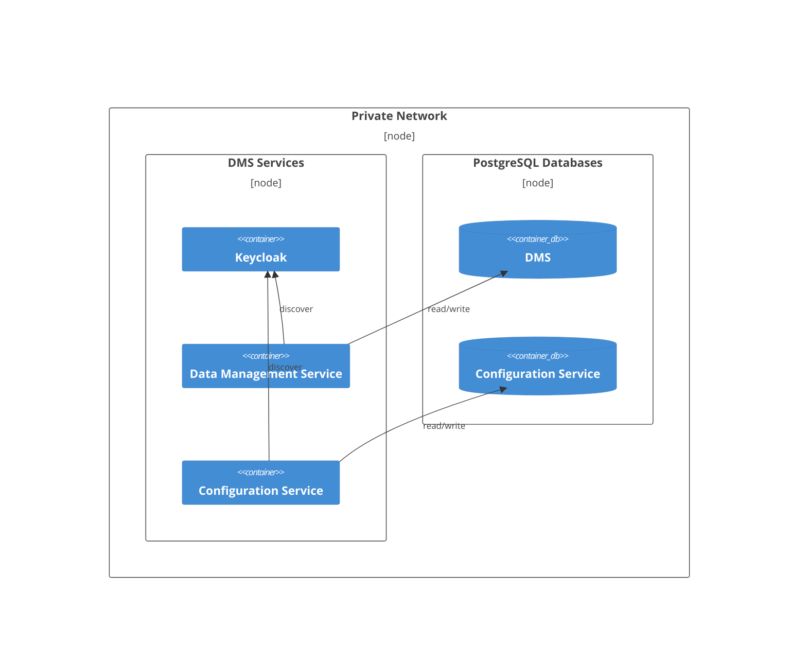

# Getting Started Using the Ed-Fi API

This file is a lab walkthrough on using the Ed-Fi API (DMS). These instructions
rely on a compatible `docker compose` command, for
example coming from Docker Engine with the Compose plugin, Docker Desktop, or
Podman. See the [docs/](./docs/) for additional developer information.

There are two parts to the lab:

* This markdown file provides context and instructions on running the Ed-Fi API.
* File `getting-started.http` provides annotated HTTP commands demonstrating how
  to interact with the DMS and the Configuration Service.

## Pre-Requisites

These instructions have been tested in Windows with current (April, 2025)
versions of both Docker Desktop and Podman. This repository uses PowerShell for
scripting, which _should_ work on any OS where PowerShell Core 7+ is installed.
The bootstrap also runs the in-repository `api-schema-tools` CLI on the host, so
the .NET 10 SDK is required.

On Linux, Docker Engine with the Compose plugin is sufficient. Verify `docker ps`
and `docker compose version` succeed before starting the stack. If the Engine is
stopped, start it with `sudo systemctl start docker`.

> [!TIP]
> If using Podman without Docker in Windows, you can create either
>
> 1. Find and replace "docker compose" with "podman compose" in the
>    `eng/docker-compose` directory, or
> 2. In Windows, create a `docker.cmd` file containing the following command:
>    `podman %*` and add the location of this file into your Path environment
>    variables.

The companion file [getting-started.http] can be executed in VS Code with the
`humao.rest-client` or similar extension. Visual Studio and Rider also have
support for this file format. This file contains all of the HTTP commands found
this lab exercise. In VS Code with Rest Client, you can generate Curl commands
from the `.http` file or generate code snippets in over a dozen languages.

We use the `bierner.markdown-mermaid` extension in VS Code for viewing Mermaid
diagrams in Code's built-in Markdown preview tool.

## Context

1. There are two custom .NET applications in this repository:
   1. The Data Management Service (DMS), which is an "Ed-Fi API" application. It
      supports the following API definitions: Ed-Fi Resources API, Ed-Fi
      Descriptors API, and Ed-Fi Discovery API. It includes Ed-Fi Data Standard
      5.2 out of the box. It will be capable of supporting other Data Standard
      versions at a future date.
   2. The Configuration Service, which implements a form of the Ed-Fi
      Management API, whose specification is derived from the legacy Ed-Fi Admin
      API 2 application.
2. Both systems use PostgreSQL for online transaction processing (OLTP) data
   storage. DMS stores each Ed-Fi Resource in its own set of relational tables
   derived from the effective schema, while Descriptors are stored in the
   shared `dms.Descriptor` table; see the [Relational Backend Developer
   Guide](./docs/RELATIONAL-BACKEND.md).
3. Relational DMS CDC/Kafka support is pending a separate implementation.



## Start the Containers

In a terminal, switch to the `eng/docker-compose` directory. Create a new file
`.env` as a copy of `.env.example`. There is no need to modify the file for
local execution. However, please change the passwords if using for anything
other than firewalled local development.

```powershell
cd Data-Management-Service/eng/docker-compose
cp .env.example .env
```

The bootstrap automatically publishes the schema tool from source when it
cannot find an eligible executable, then reuses it on later runs. This first
startup can take longer while the .NET 10 SDK publishes the tool. After changing
the tool or switching to a branch that changes it or its dependencies, refresh
the cached tool with the following command, or delete its cache directory so the
next bootstrap can resolve it again. Building the solution alone does not
refresh the cache, which takes precedence over build output:

```powershell
$schemaToolProject = "../../src/dms/clis/EdFi.DataManagementService.SchemaTools/EdFi.DataManagementService.SchemaTools.csproj"
$schemaToolOutput = ".bootstrap/tools/api-schema-tools"
dotnet publish $schemaToolProject -c Release -p:UseAppHost=true -o $schemaToolOutput
```

Start the complete local environment with the bootstrap wrapper:

```powershell
./bootstrap-local-dms.ps1
```

The wrapper stages the schema and claims workspaces, starts the infrastructure,
configures the data store, provisions its schema, and then starts DMS. Application
images build inside containers. Startup may take around a minute, with additional
time for the first schema tool publish when no eligible executable is available.

Existing local images are reused by default, and stopping the stack (even with
`-d -v`) does not remove them. After updating your checkout, rebuild them before
startup by explicitly passing `-Rebuild` (or its shorter `-r` alias):

```powershell
./bootstrap-local-dms.ps1 -Rebuild
```

For advanced workflows that need phase-level control, the individual commands
remain available. For example, `start-local-dms.ps1 -InfraOnly` starts the
infrastructure without DMS, and `configure-local-data-store.ps1` registers or
selects the data store. Their help and terminal guidance describe the inputs for
the subsequent provisioning and DMS-start phases.

Once started, try the following HTTP request, which will load the Ed-Fi
Discovery API endpoint from the DMS.

```shell
curl http://localhost:8080
```

## Interacting with the Two Services

Please open [getting-started.http](./getting-started.http) for detailed
instructions and sample HTTP commands. If using the Rest Client extension, you
can right-click on any command to generate a Curl command. Alternatively, you
can create a code snippet in one of more than a dozen supported languages,
including C# and Python.

To authenticate with DMS, first call the Discovery endpoint and read the DMS
token-proxy URL from `urls.oauth`. POST the client-credentials grant to that URL
using HTTP Basic credentials:

```http
###
# @name discovery
GET http://localhost:8080

###
@tokenUrl={{discovery.response.body.urls.oauth}}

###
POST {{tokenUrl}}
Authorization: Basic <client-id>:<client-secret>
Content-Type: application/x-www-form-urlencoded

grant_type=client_credentials
```

The DMS token proxy accepts the client credentials through the `Authorization`
header, as shown. Like the ODS/API, it also accepts `client_id` and
`client_secret` in a form or JSON body instead, but not combined with a Basic
header; see the
[ADR](./reference/adr-oauth-token-client-credentials-DMS-1604.md). The example
uses Rest Client syntax, which Base64-encodes `<client-id>:<client-secret>`
before sending; other HTTP clients must send the standard Base64-encoded Basic
value, for example with
`curl -u <client-id>:<client-secret>`. Calling the Configuration Service `/connect/token`
endpoint directly is a separate endpoint contract; see the working examples in
[getting-started.http](./getting-started.http).

For the most part, interacting with the Data Management Service is the same as
interacting with the Ed-Fi ODS/API. The following ODS/API documentation pertains
to the Data Management Service and will provide additional background
information on developing client integrations:

* [Basics](https://docs.ed-fi.org/reference/ods-api/client-developers-guide/basics)
* [Authentication](https://docs.ed-fi.org/reference/ods-api/client-developers-guide/authentication)
* [Date and Datetime
  Elements](https://docs.ed-fi.org/reference/ods-api/client-developers-guide/date-datetime-elements)
* [Descriptor
  References](https://docs.ed-fi.org/reference/ods-api/client-developers-guide/descriptor-references)
* [Error Handling and Best
  Practices](https://docs.ed-fi.org/reference/ods-api/client-developers-guide/error-handling-best-practices)
* [Error Response Knowledge
  Base](https://docs.ed-fi.org/reference/ods-api/client-developers-guide/error-response-knowledge-base)
* [Resource Dependency
  Order](https://docs.ed-fi.org/reference/ods-api/client-developers-guide/resource-dependency-order)
* [Using Code Generation to Create an
  SDK](https://docs.ed-fi.org/reference/ods-api/client-developers-guide/using-code-generation-to-create-an-sdk)

In the DMS we have not included the `v3/` segment that is present in the
ODS/API. This segment was never part of a formal standard, and we felt that it
was a leftover vestige from the change between ODS/API 2.x and ODS/API 3.x.

## Modifying the Configuration

Explore the `.env` file you just created to see what configuration options are
available; however, most of them should not be altered. After editing the
`.env`, stop and then restart the containers.

## Load Seed Data

The bootstrap wrapper can load the built-in Minimal or Populated seed data
through the running API after it configures and provisions the data store. For
example:

```powershell
./bootstrap-local-dms.ps1 -LoadSeedData -SeedTemplate Minimal
```

Use `-SeedTemplate Populated` for the populated sample. The wrapper also accepts
`-SeedDataPath` for developer-supplied XML interchange files; see
`Get-Help ./bootstrap-local-dms.ps1 -Detailed` for that expert workflow.

## Restore the Datastore from a Database Template Package

The supported way to initialize the datastore from a database-template package
is the bootstrap wrappers' restore mode. Set the package's NuGet version in `.env`
for feed-based restores. The package ID in `.env` is not always the effective one:
a process environment value wins, `bootstrap-local-dms.ps1` always replaces it with
the Data Standard overlay's value (following `-DataStandardVersion`), and
`bootstrap-published-dms.ps1` does so only when `-DataStandardVersion` is passed.
The restore then swaps in the requested kind and engine. See "Restoring the
datastore from a database template" in `eng/docker-compose/README.md`.

**Example:**

```env
DATABASE_TEMPLATE_PACKAGE=EdFi.Api.Minimal.Template.PostgreSql.5.2.0
DATABASE_TEMPLATE_NUGET_VERSION=1.0.123
```

Then run one restore invocation, which authenticates the package against the
template trust policy, validates it against a freshly prepared workspace and a
throwaway scratch database, and only then replaces the target datastore before
starting the stack:

```powershell
./bootstrap-local-dms.ps1 -RestoreTemplate Minimal
```

The tracked trust policy, `eng/docker-compose/template-trust-policy.json`,
currently lists no trusted producers, so a feed restore refuses every package
for now. That empty policy is intentional fail-closed behavior: a feed restore
requires a package attested by a producer configured as a trust anchor in that
policy (or in your local overlay). Older packages that lack the restore manifest
and attestation are not eligible for `-RestoreTemplate`, even though the
database engine could still read their `.sql` or `.bak` artifact; engine-level
backup compatibility does not make a package eligible for the guarded bootstrap
restore.

Use `-PackageDirectory <path>` to restore from a local directory holding the
template `.nupkg` and its sibling attestation document instead of the feed (no
NuGet version key needed). See `eng/docker-compose/README.md` for the full
restore documentation, including the trust-policy setup for locally built
packages.

The older `setup-database-template.psm1` module remains available as a
legacy/manual path only, pending its deletion gate; it performs none of the
restore mode's authentication or validation.

## Stopping the Containers

When you are ready to stop the containers, append the `-d` ("down") flag to the
command:

```powershell
./bootstrap-local-dms.ps1 -d
```

And to shut down and delete all data, add the `-v` ("volumes") flag. This also
removes the staged `.bootstrap/` workspace, which is useful when you need to
start over with a clean slate. Pass the same infrastructure options you started
with, such as `-DatabaseEngine`, so the command stops the same services.

```powershell
./bootstrap-local-dms.ps1 -d -v
```

Because `-d -v` also clears the cached schema tool, the next bootstrap reuses an
eligible executable from build output or publishes it automatically. Publishing
requires the host .NET 10 SDK. If you set `DMS_SCHEMA_TOOL_PATH` to a deleted
executable, clear or update that override before restarting; explicit paths fail
closed rather than triggering automatic publishing.
