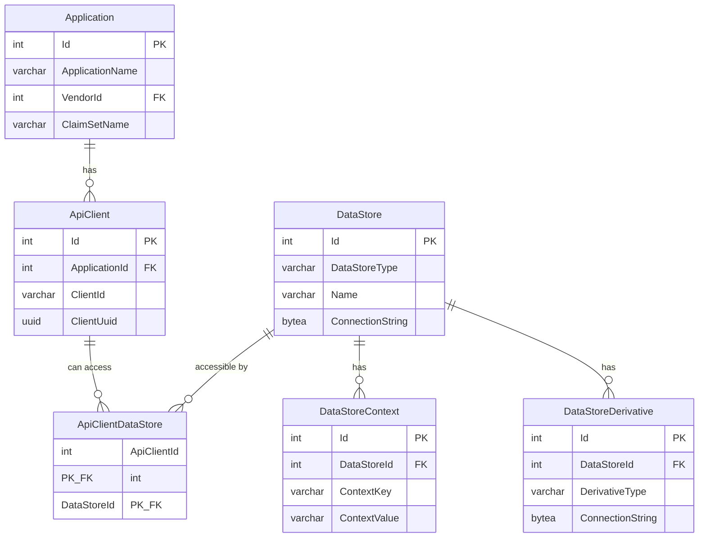

# API Client and Data Store Configuration

## Overview

The Ed-Fi API Configuration Service manages API client
credentials and data store routing through a dedicated configuration database.
This database stores vendor and application information, API client credentials,
data store connection strings, and route context mappings for multi-tenant
deployments.

All configuration data resides in the `dmscs` (Configuration Service) schema
within the configuration database.

## Prerelease Rename Note

DMS-1198 renames the prerelease Configuration Service management contract and database objects
from DMS instance terminology to data store terminology. Deployments upgrading
from alpha builds that already created `DmsInstance*` Configuration Service tables should recreate
the Configuration Service configuration database, or run an operator-managed migration that copies
the old `DmsInstance*` rows into the new `DataStore*` tables before using the
new Configuration Service API routes. The DMS-1198 branch does not provide an in-place migration
from the old prerelease Configuration Service table names.

External Configuration Service callers must update from the old DMS instance route and JSON field
names to the `dataStore*` routes and `dataStore*` payload fields.

## Ed-Fi DMS Data Stores

### Data Store Storage and Security

The connection strings for data stores are configured in the Configuration
Service database and stored in the `DataStore` table. For security purposes,
connection strings are encrypted using AES encryption to protect database
credentials from unauthorized access.

### API Client to Data Store Association

Each API client can be associated with zero, one, or many data stores. In the
simplest case, each API client has access to a single instance, providing a
streamlined experience where the client uses a fixed API base URL (e.g.,
`http://localhost:8080/data/ed-fi/students`).

#### Clients With No Data Store Assignment

A client may be created and administered with no data store assignment at all.
Such a client authenticates normally and is issued a token, but the token
conveys no data store, so the client reaches no data store and no resource data.
It exists so an operator can provision a client for operations that are not
scoped to a data store, and it is provisioned through the ordinary API-client
lifecycle rather than through any special route.

On `POST /v3/apiClients` and `PUT /v3/apiClients/{id}`, the request's
`dataStoreIds` behaves as follows:

| Request value | Behavior |
| --- | --- |
| `[]` | Accepted. The client is created, or updated, with no data store assignment. |
| omitted | Accepted, and identical to `[]`. |
| `null` | Rejected with `400` and a `DataStoreIds` validation error. |
| `[1, 2]` | Accepted when every id exists **in the caller's tenant**. |
| ids that are absent, or belong to another tenant | Rejected with `409` unresolved reference; nothing is created, and on update the client's existing assignment is left unchanged. |

Application creation is a separate contract and only its empty-list path is
described here: `POST /v3/applications` with `"dataStoreIds": []` is accepted
and creates the application's initial client with no data store assignment,
which is the supported way to provision one. The table above states the
API-client endpoints' behavior and does not describe how the application
endpoints treat other `dataStoreIds` values.

Two properties of this contract are easy to get wrong:

- **`PUT` replaces the whole list.** An empty *or omitted* `dataStoreIds` on
  `PUT /v3/apiClients/{id}` removes every assignment the client currently has.
  There is no partial update, so a caller that omits the field to "leave it
  alone" will instead clear it.
- **An empty list is not a wildcard.** It grants nothing, and it does not widen
  visibility across tenants: a client with no assignment is exactly as invisible
  to another tenant as one with an assignment.

Removing a client's last data store assignment does not relax anything else.
Approval is still required to obtain a token: this contract changes neither
`isApproved` nor how it is enforced, and the approval gate does not consider a
client's data store assignments. Ownership configuration, credential handling
and tenant isolation are likewise unaffected.

The `dataStoreIds` **token claim** for such a client differs between the two
supported identity providers, and consumers must treat the two as the same
outcome:

- **self-contained (OpenIddict)** issues the claim with an empty value.
- **Keycloak** omits the claim entirely, because it registers no protocol
  mapper for an empty assignment.

So "no data stores" is represented as either an empty `dataStoreIds` claim or
an absent one, depending on the deployment's identity provider.

#### Provisioning a Client With No Data Store Assignment

The sequence below is the whole lifecycle, using only endpoints that exist
today. Two different identifiers are involved:

- the **numeric `id`** returned in the API-client response body is the
  management identifier used in `PUT`, `DELETE` and `reset-credential` routes;
- the **`clientId`** (returned as `key` when credentials are issued) is the
  OAuth client identifier.

The single-item `GET` accepts either one and resolves them key-first. The
segment is matched against the OAuth `clientId` key, and that match wins
whenever it exists. Only when no client key matches, and the segment is a valid
32-bit integer, is it read as the numeric `id`. Key-first is deliberate: a
`clientId` has no enforced format, so a key made only of digits is possible, and
reading the numeric `id` first could hand back an unrelated client. The two
values remain distinct, because a client's `id` and its `key` are different
values resolved through different columns. You just do not have to convert one
into the other to read a client.

`POST /v3/applications` returns the **application's** id in `id`, not the
initial client's. To act on that client, read it with
`GET /v3/apiClients/{key}` and take the numeric `id` from that response.

1. **Create a vendor** — `POST /v3/vendors`.
2. **Create an application with no data store** —
   `POST /v3/applications` with `"dataStoreIds": []`. The response carries the
   application `id` plus the `key` and `secret` of an initial client that has no
   data store assignment.
3. **Read the initial client** — `GET /v3/apiClients/{key}`. The response shows
   `"dataStoreIds": []` and supplies that client's numeric `id`.
4. **Add another client, if needed** — `POST /v3/apiClients` with
   `"dataStoreIds": []` (or with the property omitted). The response carries the
   new client's numeric `id`, `key` and `secret`.
5. **Update a client** — `PUT /v3/apiClients/{numeric id}`. Sending
   `"dataStoreIds": []` keeps the client unassigned. The response is `204` and
   returns no credentials, so the current key and secret remain valid.
6. **Reset credentials** — `PUT /v3/apiClients/{numeric id}/reset-credential`
   with an empty body `{}`. The response returns the client's **new** secret
   alongside its unchanged key; use the returned pair from then on. The data
   store assignment is untouched.
7. **Exchange the current credentials for a token** — `POST /connect/token` as
   `application/x-www-form-urlencoded`. The client's current `key` and `secret`
   are values, not parameter names: send them as the form fields `client_id` and
   `client_secret`, with `grant_type=client_credentials` and `scope` set to the
   application's **claim set name**.

   ```text
   grant_type=client_credentials&client_id=<key>&client_secret=<secret>&scope=<claim set name>
   ```

   The scope may be omitted: the token endpoint then forwards no `scope`, and
   the client receives its default scopes (its default client scopes under
   Keycloak, its registered scopes under the self-contained provider). Under
   Keycloak, a scope the client is not granted answers `400` with
   `invalid_scope`.
8. **Delete a client** — `DELETE /v3/apiClients/{numeric id}`, after which
   both `GET /v3/apiClients/{numeric id}` and `GET /v3/apiClients/{key}` report
   `404`.

What the resulting token can *do* is governed by the DMS identity surface under `/identity/v2/identities`, which DMS maps only when `DataManagement:IdentityManagement:Enabled` is `true` (see [Configuration](./CONFIGURATION.md)).
With the surface enabled, the token reaches the identity operations its claim set grants, and it grants no resource access.
Those operations run only when an identity provider plugin is registered; without one, an otherwise authorized request answers `404` with `urn:ed-fi:api:identities:operation-not-supported`.
This section documents only how to provision such a client in the Configuration Service and confirm its credentials work.
How quickly a deletion, a credential reset or a claim set change reaches the identity operations is in [How long a change takes to apply](./IDENTITY-MANAGEMENT.md#how-long-a-change-takes-to-apply), and the rest of the operator's side is in [Identity Management](./IDENTITY-MANAGEMENT.md).

### Applications Without API Clients

`POST /v3/applications` accepts an optional `createDefaultCredentials` flag. It
defaults to `true`, which keeps the existing flow: the Configuration Service
creates the application's initial API client, assigns it the request's
`dataStoreIds`, and returns its `key` and `secret`.

With `"createDefaultCredentials": false`, the Configuration Service creates the
application, its education organizations and its profiles, and creates no API
client and no identity provider client. The request must omit `enabled` and
`dataStoreIds`, which describe the initial client:

```json
{
  "applicationName": "District SIS",
  "vendorId": 1,
  "claimSetName": "SIS-Vendor",
  "educationOrganizationIds": [255901],
  "profileIds": [],
  "createDefaultCredentials": false
}
```

The response is `201 Created` with explicit null credentials:

```json
{
  "id": 7,
  "key": null,
  "secret": null
}
```

Sending `enabled` or `dataStoreIds` together with `false` returns `400` with an
`Enabled` or `DataStoreIds` validation error, whatever the value, so `false`,
`null` and `[]` are rejected too. When the flag is omitted or `true`, `enabled`
is ignored, as before. Add clients afterwards with `POST /v3/apiClients`.

An application can also reach zero clients when its last client is deleted with
`DELETE /v3/apiClients/{id}`. That leaves the application in place, and it
behaves the same as one created without clients:

- `GET /v3/applications`, `GET /v3/applications/{id}` and
  `GET /v3/vendors/{id}/applications` report `"enabled": false` and
  `"dataStoreIds": []`. `enabled` is `true` only when the application has at
  least one client and every client is approved, and `dataStoreIds` is the
  union of its clients' data store assignments.
- `PUT /v3/applications/{id}/reset-credential` returns `409 Conflict`, as it
  does for an application with more than one client, and resets nothing. A
  missing application still returns `404`. Reset a specific client with
  `PUT /v3/apiClients/{id}/reset-credential`.
- `POST /v3/apiClients` adds a client to it, and
  `DELETE /v3/applications/{id}` deletes it.

`PUT /v3/applications/{id}` updates an application with no clients like any
other and returns `204` without calling the identity provider.

### API Client Education Organization Scope

Every API client carries its own education organization scope. A client either
**inherits** its Application's education organizations or is **narrowed** to a
subset of them, requested as a non-empty list. The scope becomes the client's
`educationOrganizationIds` token claim, which DMS uses for relationship-based
authorization. An SEA can keep one Application per vendor product and give each
LEA its own credentials, limited to that LEA's education organizations.

#### What a client reports

`GET /v3/apiClients`, `GET /v3/apiClients?applicationId={id}` and
`GET /v3/apiClients/{key or numeric id}` return two fields for every client:

- `inheritsApplicationEducationOrganizations` is the stored flag: `true` for an
  inheriting client, `false` for a narrowed one.
- `educationOrganizationIds` is the client's **effective** list, in ascending
  order. For an inheriting client it is the Application's current list; for a
  narrowed client it is the client's own list. It is always present and never
  `null`.

A client narrowed to a list equal to its Application's whole list stays
narrowed: it reports `false` and does not pick up education organizations added
to the Application later.

A narrowed client whose education organizations are all removed from its
Application reports `"educationOrganizationIds": []`. That effective scope grants
no education organization access; the client stays approved and still
authenticates. Its token claims can lag the saved scope: tokens already issued
keep their claims until they expire, and a client the identity provider could
not update stays pending until it is updated (see
[Application changes](#application-changes)). Namespace-based
permissions are a separate claim and are not affected. To withdraw a client's
access on purpose, disable it (`"isApproved": false`) or delete it; a request
cannot set an empty list. An inheriting client of an Application with no
education organizations also reports `[]`.

The item route resolves its segment key-first, as described in
[Provisioning a Client With No Data Store Assignment](#provisioning-a-client-with-no-data-store-assignment).
`PUT`, `DELETE` and `reset-credential` take only the numeric `id`.

#### Request rules

`POST /v3/apiClients` and `PUT /v3/apiClients/{id}` accept two optional fields,
`educationOrganizationIds` and `inheritsApplicationEducationOrganizations`:

| Request | Result |
| --- | --- |
| Neither field, on `POST` | The client inherits. |
| Neither field, on `PUT` | The client keeps its flag and list. |
| `"educationOrganizationIds": [...]` without the flag, or with `false` | The client is narrowed to the list, even when it equals the Application's list. Duplicates are removed. |
| `"inheritsApplicationEducationOrganizations": true` without a list | The client inherits. |
| `true` with a list equal to the Application's non-empty list, in any order | The client inherits. An inheriting client read with `GET` can be sent back unchanged when its list is not empty. |
| `true` with any other list | `400` on `EducationOrganizationIds`. |
| `false` without a list | `400` on `InheritsApplicationEducationOrganizations`. |
| `"educationOrganizationIds": []` or `null` | `400` on `EducationOrganizationIds`. |
| `"inheritsApplicationEducationOrganizations": null` | `400` on `InheritsApplicationEducationOrganizations`. |
| A list with an id that is not on the client's Application (the new Application on a move) | `400` on `EducationOrganizationIds`, naming the missing ids. |

These `400` responses use type `urn:ed-fi:management-api:bad-request:data` and
change nothing.

An empty list is never accepted, even when the Application has no education
organizations. When `GET` reports `"educationOrganizationIds": []`, omit both
scope fields on `PUT` to keep the client's scope, or send
`"inheritsApplicationEducationOrganizations": true` without a list to make it
inherit.

`PUT /v3/apiClients/{id}` replaces the whole client. It requires `id` (equal to
the route id), `applicationId`, `name` and `isApproved`. `dataStoreIds` is a
full replacement that is independent of the scope: omitting it removes every
data store assignment, as described in
[Clients With No Data Store Assignment](#clients-with-no-data-store-assignment).
Send the client's current `dataStoreIds` with every scope change that is meant
to keep them.

Narrow a new client:

```json
{
  "applicationId": 7,
  "name": "LEA 255901",
  "isApproved": true,
  "dataStoreIds": [1],
  "educationOrganizationIds": [255901]
}
```

Narrow an existing client (numeric id 12), keeping its data store assignment:

```json
{
  "id": 12,
  "applicationId": 7,
  "name": "LEA 255901",
  "isApproved": true,
  "dataStoreIds": [1],
  "educationOrganizationIds": [255901, 255950]
}
```

Make it inherit again:

```json
{
  "id": 12,
  "applicationId": 7,
  "name": "LEA 255901",
  "isApproved": true,
  "dataStoreIds": [1],
  "inheritsApplicationEducationOrganizations": true
}
```

#### Moving a client to another Application

A `PUT` with a different `applicationId` moves the client. The move, the
client's new scope and its data store assignment are saved together, or not at
all.

- An **inheriting** client sent with neither scope field adopts the new
  Application's list.
- A **narrowed** client sent with neither scope field keeps its list when every
  id in it is on the new Application. Otherwise the request returns `409` with
  type `urn:ed-fi:management-api:conflict:education-organization-scope`, the
  detail names the missing ids, and nothing changes.
- To move a client whose list does not fit, send `educationOrganizationIds`
  that are on the new Application, or `"inheritsApplicationEducationOrganizations": true`.

The `409` is specific to an omitted scope on a move. A list that the request
itself sends and that is not on the new Application is a `400`, like any other
scope validation error.

#### When changes reach a token

A successful `POST` or `PUT` on `/v3/apiClients` sends the client's effective
list to the identity provider, under both the self-contained provider and
Keycloak. Tokens requested after that carry the new list. Tokens already issued
keep their claims until they expire; this change does not revoke them.

An empty effective list appears in the token as one empty
`educationOrganizationIds` claim under the self-contained provider, and as no
claim under Keycloak. DMS treats both as no education organization access.

`PUT /v3/apiClients/{id}/reset-credential` changes only the secret. The new
secret works and the old one stops working. The stored flag, the stored list
and the claims held by the identity provider are kept as they are. A reset does
not refresh claims and does not complete a pending synchronization.
`PUT /v3/applications/{id}/reset-credential` still returns `409` for an
Application with zero or several clients; reset a specific client instead.

#### Application changes

`PUT /v3/applications/{id}` saves the change first. One transaction saves the
Application and marks every client the change affects as pending an identity
provider update:

- A name or claim set change affects every client.
- An added or removed education organization affects every inheriting client.
- A removed education organization also affects each narrowed client that held
  it. A narrowed client keeps its narrowing: it loses removed ids and never gains
  added ones, even when its list equals the Application's whole list.

A change to profiles or the vendor alone affects no client. The database follows
for every client right away: removed ids leave every client's stored list, and
`GET` reports each client's effective list.

The Configuration Service then updates each pending client of the Application in
the identity provider, one after another in id order, and clears a client's
pending marker once the provider confirms its update. Each client receives the
Application's name and claim set with its own effective list, data stores and
approval. Clients left pending by an earlier request are included. Tokens
requested afterwards carry the change; tokens already issued keep their claims
until they expire.

- `204`: no client of the Application is pending.
- `502` with type `urn:ed-fi:management-api:bad-gateway:partial-sync`: the
  Application change is saved, but some clients are still pending. `detail`
  counts them and `apiClientIds` lists their numeric ids, for example
  `"apiClientIds": [12, 15]`. Their tokens can keep their earlier claims until
  they are updated.

A pending client is updated by any of these:

- Sending the same `PUT /v3/applications/{id}` again. Only the pending clients
  are sent to the identity provider.
- A later Application update that affects the client, or any later Application
  update while it is still pending.
- A successful `PUT /v3/apiClients/{id}` of the client, even one that changes
  nothing. A failed client update keeps the client pending.

There is no scheduled retry. An unchanged Application update does not refresh
clients that are not pending, and a credential reset neither refreshes claims
nor completes a pending update. The Application update never changes client
keys, secrets, names, approval, data stores or scope choices.

Renaming a claim set (`PUT /v3/claimSets/{id}`) also renames it on every
Application that uses it and marks every client of those Applications pending,
but it does not update the identity provider itself. Until a client is updated
by one of the ways above, its tokens carry the old claim set name, which DMS no
longer recognizes, so its requests are refused. After a rename, send each
affected Application's `PUT /v3/applications/{id}` again, unchanged.

#### Upgrading from 8.0

Before 8.1, an Application update refreshed only the Application's first client,
so another client's identity provider claims can still hold education
organizations, a name or a claim set the Application no longer has. The upgrade
cannot read the identity provider, so it makes every existing client inherit its
Application's current list and marks every existing client pending. Until a
client is updated, `GET /v3/apiClients` reports the Application's list while the
client's tokens can still carry its earlier claims.

To bring every client in line, send each Application's current definition with
`PUT /v3/applications/{id}`, unchanged if nothing needs to change. That request
updates every client of the Application, as described above. A
`PUT /v3/apiClients/{id}` updates a single client. A client whose identity
provider client no longer exists cannot be updated and stays pending, and every
update of its Application returns `502` naming it; delete that client with
`DELETE /v3/apiClients/{id}`.

#### SEA workflow: one Application, a client per LEA

1. **Create the Application without credentials.** Use the vendor product's
   claim set and the full list of education organizations any LEA may need.
   Omit `enabled` and `dataStoreIds`, which describe a default client:

   ```json
   {
     "vendorId": 3,
     "applicationName": "Vendor SIS",
     "claimSetName": "SIS-Vendor",
     "educationOrganizationIds": [255901, 255950, 255902],
     "profileIds": [],
     "createDefaultCredentials": false
   }
   ```

   The response is `201` with `"key": null` and `"secret": null`; see
   [Applications Without API Clients](#applications-without-api-clients).

2. **Create one client per LEA** with `POST /v3/apiClients`. Give each its own
   non-empty list and explicit `dataStoreIds` and `isApproved`:

   ```json
   {
     "applicationId": 7,
     "name": "LEA 255902",
     "isApproved": true,
     "dataStoreIds": [1],
     "educationOrganizationIds": [255902]
   }
   ```

   The `201` response carries that client's `id`, `key` and `secret`. Each LEA
   receives only its own key and secret, for example through its security
   administrator.

3. **Check the result** with `GET /v3/apiClients?applicationId=7`:

   ```json
   [
     {
       "id": 12,
       "applicationId": 7,
       "clientId": "<key>",
       "clientUuid": "<uuid>",
       "name": "LEA 255901",
       "isApproved": true,
       "creatorOwnershipTokenId": null,
       "ownershipTokenIds": [],
       "dataStoreIds": [1],
       "inheritsApplicationEducationOrganizations": false,
       "educationOrganizationIds": [255901, 255950]
     },
     {
       "id": 13,
       "applicationId": 7,
       "clientId": "<key>",
       "clientUuid": "<uuid>",
       "name": "LEA 255902",
       "isApproved": true,
       "creatorOwnershipTokenId": null,
       "ownershipTokenIds": [],
       "dataStoreIds": [1],
       "inheritsApplicationEducationOrganizations": false,
       "educationOrganizationIds": [255902]
     }
   ]
   ```

4. **Change an LEA's list** with `PUT /v3/apiClients/{id}`, sending all
   required fields as shown under [Request rules](#request-rules). The LEA's next
   token carries the new list.

5. **Replace an LEA's secret** with
   `PUT /v3/apiClients/{id}/reset-credential` and an empty body `{}`. The
   response carries the client's unchanged `key` and new `secret`.

The education organization list limits a client only where its claim set uses
education-organization relationship authorization. The claim set still
decides which resources and actions the client has, and the client reaches data
only in its assigned data stores. With a claim set using relationship-based
authorization, an LEA client narrowed to its own school reads that school's
records, and a read of another LEA's school's record is denied with `403`
(`urn:ed-fi:api:security:authorization`). Any client of the Application whose
list lost an education organization, or became empty, through an Application
change is denied that organization's records the same way with a token
requested after that client's identity provider update succeeds. A client still
pending after a `502` can keep its earlier claims until then.

### Context-Based Routing

Alternatively, the DMS supports **context-based routing**, which allows a
single API client to access multiple data stores by including route
qualifiers in the request URL. This approach combines API client/data store
associations with route context values to determine which database should
handle each request.

When context-based routing is enabled, route qualifiers are included in the
API path (e.g., `http://localhost:8080/255901/2024/data/ed-fi/students`),
where `255901` and `2024` represent contextual values such as district ID and
school year.

The `DataStoreContext` table stores the context key-value pairs for
each data store, enabling the DMS API to match incoming route qualifiers
against configured data stores.

### Related Tables



#### DataStore

Stores data store definitions and encrypted connection strings.

| Column | Type | Description |
|--------|------|-------------|
| Id | INT | Primary key |
| DataStoreType | VARCHAR(50) | Data store classification |
| Name | VARCHAR(256) | Human-readable data store name |
| ConnectionString | BYTEA | Encrypted database connection string |
| TenantId | BIGINT | Owning tenant; null in a single-tenant deployment |

**Constraint:** `UNIQUE (TenantId, Name)` ensures data store names are unique
within a tenant; in a single-tenant deployment, where `TenantId` is null, they
are unique across the deployment. A duplicate name is rejected with `400`, on
`POST` and on a `PUT` that renames a data store.

#### DataStoreContext

Stores context key-value pairs for route-based data store resolution.

| Column | Type | Description |
|--------|------|-------------|
| Id | INT | Primary key |
| DataStoreId | INT | Foreign key to DataStore |
| ContextKey | VARCHAR(256) | Context dimension name |
| ContextValue | VARCHAR(256) | Context value |

**Constraint:** `UNIQUE (DataStoreId, ContextKey)` ensures each data store has
only one value per context key.

#### DataStoreDerivative

Stores derivative data stores (read replicas and snapshots) associated with a parent data store.

| Column | Type | Description |
|--------|------|-------------|
| Id | INT | Primary key |
| DataStoreId | INT | Foreign key to parent DataStore |
| DerivativeType | VARCHAR(50) | Type of derivative: "ReadReplica" or "Snapshot" |
| ConnectionString | BYTEA | Encrypted database connection string |

**Foreign Key:** CASCADE DELETE on `DataStoreId` - when a parent DataStore is
deleted, all its derivative data stores are automatically deleted.

**Constraint:** `UNIQUE (DataStoreId, DerivativeType)` ensures each data store
has at most one ReadReplica and at most one Snapshot. Its backing index leads
with DataStoreId, so it also serves lookups by parent data store and the
child-side foreign-key maintenance.

**Constraint:** a check constraint restricts `DerivativeType` to exactly
"ReadReplica" or "Snapshot", compared ordinally including length, so case and
whitespace variants are rejected in both engines.

#### ApiClient

Stores OAuth client credentials for applications.

| Column | Type | Description |
|--------|------|-------------|
| Id | INT | Primary key |
| ApplicationId | INT | Foreign key to Application |
| ClientId | VARCHAR(36) | OAuth client identifier |
| ClientUuid | UUID | Globally unique client identifier |
| Name | VARCHAR(50) | Human-readable client name |

**Constraint:** `UNIQUE (ApplicationId, Name)` ensures API client names are
unique within an application; clients of different applications may share a
name. A duplicate name is rejected with `400`, on `POST` and on a `PUT` that
renames a client or moves it to another application.

#### ApiClientDataStore

Maps API clients to data stores they can access (many-to-many).

| Column | Type | Description |
|--------|------|-------------|
| ApiClientId | INT | Foreign key to ApiClient |
| DataStoreId | INT | Foreign key to DataStore |

## Data Store Derivatives

Data Store Derivatives are alternate database instances associated with a parent
data store, such as read replicas or snapshots. Read replicas distribute query
load, while snapshots preserve point-in-time data for backup, testing, or analysis.

A `Snapshot` derivative must reference a database that is frozen for the duration
of a client's paging session. Change-version-filtered collection reads served
from a snapshot are paged in change-version order, and that ordering is only safe
over data that cannot change while it is being walked. Configuring a source that
continues to apply changes — a live secondary, or a standby still shipping logs —
as a `Snapshot` rather than a `ReadReplica` can silently return one document
twice and skip another within a single walk, with no error reported. A
`ReadReplica` carries no such requirement: reads served from one keep the live
paging rule. See [Cursor Paging](./CURSOR-PAGING.md).

The requirement covers the derivative's identity as well as the database behind
it. While reads against a snapshot are in progress, do not re-point the
derivative at a different connection string, and do not re-create the database
behind an unchanged one. Where the replacement is provisioned to the same
effective schema, neither is reported: the pages already returned are not
re-read, and the reads finish normally with their pages drawn from two different
points in time. Re-creating the database at an unchanged connection string is the
more severe of the two, because no configuration changed and nothing keyed on the
connection string can observe the substitution. A replacement provisioned to a
*different* effective schema is reported, as `503` with an effective-schema-hash
mismatch, because that much the fingerprint check can see.

Two changes do interrupt the reads rather than silently answering them from a
different copy, and the two are answered differently. Removing the derivative row
leaves nothing to select: the request is answered `404` with
`Snapshot not found.`, decided during target selection before any database is
opened. Dropping the snapshot database, or otherwise making a still-configured
derivative unreachable, is invisible to selection — the connection string is
still there and still non-blank — so the request travels on and fails when the
connection is acquired, and is answered `503` with a service-configuration error
describing a transient fault.

The distinction matters to a client that retries. The `503` is transient: the
next request at the same unchanged connection string succeeds once the database
is reachable again, and no cached verdict has to be cleared first. The `404` is
not transient — it says the deployment no longer offers a snapshot at all, and
retrying will keep returning it until a derivative is configured again.

Each derivative type is stored with its own encrypted connection string and is
automatically deleted when its parent data store is removed (CASCADE DELETE).

### Configuration

Data store and route context configuration is managed through the DMS
Configuration Service REST API. See the
[Database segmentation documentation](DATABASE-SEGMENTATION-STRATEGY.md) for detailed
configuration examples and usage patterns.
