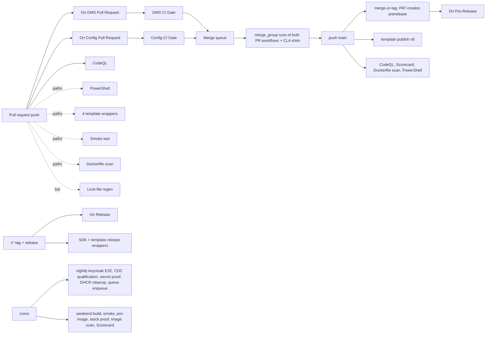
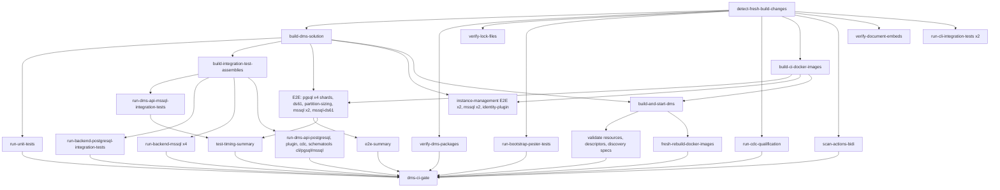

# Data-Management-Service: CI/CD Workflow Review

**Audience:** senior DevOps engineer, new to this repo, coming from GitLab CI
**Status:** DRAFT for team review. Proposals only. Nothing in the repo was changed.
**Context:** Jira DEVOPS-157 (epic DEVOPS-154). Concise version: [ci-workflow-review.md](./ci-workflow-review.md). Companions: [ci-executive-brief.md](./ci-executive-brief.md), [dockerfile-review.md](./dockerfile-review.md), [workflow-structure-review.md](./workflow-structure-review.md). Baselines: the ODS-Admin-API (DEVOPS-155) and Ed-Fi-AdminApp (DEVOPS-156) reviews, kept outside this repository.
**Data:** 4,274 workflow runs (2026-10-13 to 2026-11-12) read with `gh run list` per workflow; job and step data of 825 runs (`gh api .../runs/<id>/jobs`); the error lines of 142 failed runs (`gh run view --log-failed`); `ci_check.py` over the 36 workflow files; rulesets, environments, caches, releases and the workflow list from the GitHub API; Docker Hub tags and the Scorecard API; a read of every workflow, action, script under `eng/ci`, Dockerfile and the CI documents; a local restore and build of both solutions on a clone in a scratch directory (Apple M1 Pro, 10 cores, .NET SDK 10.0.404), with MSBuild performance summaries. Local checkout at `main` `38c758539` (2026-11-12).

---

## 1. Executive summary

1. **Scale.** 36 workflow files (15,239 lines), about 180 jobs, 4 composite actions, 10 PowerShell modules and 25 Pester test files that lint the workflows. A full DMS pull-request run has 39 job definitions (about 49 with matrices), takes **48 min median** (p90 55) and about **400 runner-minutes**; the merge queue repeats it for every merge (93 queue runs in 30 days). The repository used about **291,700 runner-minutes in 30 days**; pull requests of all workflows are 68%, the merge queue 16%, schedules 7%.
2. **Duplicate work.** The same commit is compiled by `build-dms-solution`, by `verify-dms-packages`, inside two Docker images, by CodeQL (both solutions under the tracer, 38 of its 41 minutes), by five Config PR jobs, by the template and smoke workflows, and at release once per package family. Build once is implemented inside the DMS PR workflow (a 1.1 GB artifact feeds 11 jobs, CI images are reused from GHCR) and nowhere else.
3. **Critical path.** detect (0.5 min) -> `build-dms-solution` (9.1) -> `build-integration-test-assemblies` (2.1) -> `run-dms-api-mssql-integration-tests` (28.4) -> summary -> gate. Unit tests (26 min with coverage), the CDC contract lane (18) and Pester (12) are the next longest branches. Queue time is not a problem (job median 3 s, p90 37 s); 177 jobs waited more than 2 min, all inside the 45-job fan-out.
4. **Reliability.** DMS PR runs fail 16% (47 of 290), Config 8%, the queue 5% and 12%. Bots are not the cause (3 of 16 bot runs). The non-code causes are concentrated: the prerelease contract check (18 of 19 prerelease failures; those merges published no package or image, confirmed on Docker Hub), the Windows path-length failure of the weekend build (3 of 4, fixed on 2026-11-09), a repeating Config integration assertion, Dependabot compose bumps failing a Pester parity test, the .NET CDN returning 409 one afternoon, and a smoke run where the Configuration Service did not become healthy in 300 s followed by an `openapi-generator` out-of-memory.
5. **Security.** Scorecard 8.3. CodeQL, dependency review, Hadolint, Scout, SBOM, SLSA 3 provenance, template signing, lock files, package source mapping, environment-scoped tokens, a ref-injection guard and credential-scope Pester tests all exist. Pending: environment protection rules (0 on all three), tag rulesets, non-root containers, Dependabot `docker` and `github-actions`, three `@main` references (two are the required BIDI check), an unpinned `minver-cli`.
6. **Maintainability.** 62 commits and 25,400 added lines in `.github/workflows` and `eng/ci` over 90 days; `on-dms-pullrequest.yml` grew from 548 to 4,310 lines in eleven months. Eight E2E jobs, five template wrappers and eight release chains are copies. Two workflows can never run; four registered workflows have no file.
7. **Roadmap.** Section 12. Preference: remove, merge or simplify; measured trials before any speed claim; export the DMS patterns to `Ed-Fi-Actions` rather than reinventing them in the siblings.

---

## 2. Orientation for someone coming from GitLab

### 2.1 Vocabulary map

| GitLab CI | GitHub Actions | Notes for this repo |
|---|---|---|
| `.gitlab-ci.yml` (one file) | Many files in `.github/workflows/*.yml` | 36 files. Each is its own "pipeline" with its own triggers; nine of them can start from one push. |
| Pipeline | **Workflow run** | A workflow is the file, a run is one execution. |
| Stage | No stages. Jobs are ordered with `needs:` | `dms-ci-gate` has 35 `needs`; `event_file` has 24. |
| Job | **Job** | Each job gets a fresh runner VM. About 49 per DMS PR run. |
| `script:` lines | **Steps** (`run:` for shell, `uses:` for an action) | Shell is mostly `pwsh`; the build logic lives in `build-dms.ps1` (2,630 lines) and `build-config.ps1`. |
| Runner and tags | `runs-on: ubuntu-latest` | GitHub-hosted only; one Windows job (`windows-2025-vs2026`) on Saturdays. |
| `parallel: matrix` | `strategy.matrix` | E2E shards, MSSQL shards, identity providers, data standards. |
| `rules: changes:` | `on.<event>.paths:` **or** a detect job plus `if:` on every job | The PR workflows use the detect job (`eng/ci/dms-change-categories.psm1`), so the required gate still reports. |
| `rules:` / `only:` | `on:` events and `if:` | Events here: `pull_request`, `merge_group`, `push`, `release`, `schedule`, `workflow_dispatch`, `workflow_run`, `issues`. |
| Merge trains | **Merge queue** (`merge_group` event) | Configured in the `main` ruleset: squash, one entry built at a time, up to 3 merged at once. |
| `include:` / CI components | **Reusable workflow** (`workflow_call`) and **composite action** | 3 reusable (`build-minimal-template`, `build-populated-template`, `build-sdk-package`), 4 composite actions, 2 reusable calls into `Ed-Fi-Actions`. |
| `trigger:` (downstream) | `workflow_run` | Used by `after-pullrequest.yml`, which subscribes to a name that does not exist. |
| `artifacts:` | `actions/upload-artifact` / `download-artifact` | The build output (1.1 GB, retention 1 day) and integration assemblies are passed this way. |
| Container registry | **GHCR** for CI images (by commit SHA), **Docker Hub** for releases | `ghcr.io/ed-fi-alliance-oss/data-management-service-ed-fi-api-ci:<sha>`. |
| Package registry | **Azure DevOps Artifacts** (NuGet feed `EdFi`) | Public for reads; publish needs a PAT in the `publishing` environment. |
| CI/CD variables and masked secrets | `vars.*` and `secrets.*` | Publishing secrets exist in environments; Dependabot has its own store. |
| `CI_JOB_TOKEN` | `GITHUB_TOKEN` | Cannot start other workflows, hence `EDFI_BUILD_AGENT_PAT` for prereleases and the queue enqueue. |
| Protected environment | **Environment** (`publishing`, `release-automation`, `template-attestation-signing`) | Defined; protection rules not configured yet. |
| `interruptible` + auto-cancel | `concurrency` with `cancel-in-progress` | On the PR workflows (50 cancelled DMS runs in 30 days is the feature working). |
| Renovate | **Dependabot** | `nuget` with cooldown, `docker-compose` grouped. |
| `release:` keyword | **GitHub Release** (pre-release flag) | A release event drives `on-prerelease.yml` and `on-release.yml`. |
| CODEOWNERS | CODEOWNERS | `.github/**` is owned by `@ed-fi-alliance-oss/blackbird-automation-owners`. |

### 2.2 What this repo is

Two products in one repository, built with .NET 10 and C#: the **Ed-Fi API (DMS)** in `src/dms` (46 projects in the solution) and the **Configuration Service (CMS)** in `src/config` (20 projects), plus the plugin contract tree `src/plugins` that both solutions build. Versions are centralized in `src/Directory.Packages.props` (95 packages) and locked in 66 `packages.lock.json` files. Each product has a source Dockerfile (used by CI and local stacks) and a `Nuget.Dockerfile` (used for Docker Hub). Tests: 15 unit projects, 10 integration projects, two E2E projects (Reqnroll feature files, 96 of them, sharded by category tags), Pester suites for the PowerShell tooling, and story-owned CDC qualification suites. Database templates (minimal and populated, SQL Server and PostgreSQL, two data standards) and SDK packages are built by their own workflows.

---

## 3. Inventory of the 36 workflows

| File | Lines | Events | Jobs | Concurrency | Timeouts | Notes |
|---|---|---|---|---|---|---|
| `on-dms-pullrequest.yml` | 4,310 | PR, merge_group, dispatch | 39 | yes (cancel) | 1 of 39 | The product pipeline; see section 6 |
| `on-prerelease.yml` | 2,718 | release (prereleased), dispatch | 43 | no | 0 | 8 package families x 5-job chain |
| `build-populated-template.yml` | 1,038 | workflow_call | 9 | n/a | 0 | Called by 2 wrappers + smoke |
| `build-minimal-template.yml` | 994 | workflow_call | 8 | n/a | 0 | Called by 2 wrappers |
| `on-config-pullrequest.yml` | 948 | PR, merge_group, dispatch | 14 | yes (cancel) | 0 | CMS pipeline |
| `scheduled-smoke-test.yml` | 602 | Sat 08:30, PR (20 paths), dispatch | 5 | yes | 0 | Smoke with SDK |
| `dms-weekend-build.yml` | 500 | Sat 08:00, dispatch | 7 | no | 0 | Windows VS build + E2E |
| `build-sdk-package.yml` | 466 | workflow_call | 6 | n/a | 0 | SDK packages |
| `on-release.yml` | 418 | release (released), dispatch | 4 | no | 0 | Promote + retag |
| `scheduled-pre-image-test.yml` | 300 | Sat 08:30, dispatch | 1 (matrix 4) | no | 0 | E2E on `:pre` |
| `analyze-docker-images.yml` | 263 | Sun 00:00, dispatch | 2 | yes | 0 | Weekly Scout |
| `nightly-keycloak-e2e.yml` | 202 | Sun-Fri 08:00, dispatch | 2 (matrix 4) | no | 0 | Keycloak E2E |
| `Pkg EdFi.Api.SecurityMetadataTools.yml` | 200 | dispatch | 6 | no | 0 | 1 run ever; also packed by prerelease |
| `cleanup-dms-ci-ghcr-images.yml` | 197 | Sun-Fri 08:00, dispatch | 3 | no | 0 | Keep 100, verify cache tag |
| `nightly-cdc-qualification.yml` | 190 | daily 08:17, dispatch | 3 (matrix up to 18) | no | 1 | Slack notify |
| `EdFi.Api.Populated.Template.MsSql.yml` / `.PostgreSQL.yml` | 183 each | PR (35 paths), push main + v*, release, dispatch | 3 each | yes | 0 | Wrappers over the reusable |
| `on-pullrequest-dockerfile.yml` | 178 | push main, PR (Dockerfiles), dispatch | 1 (matrix 2) | yes | 0 | Hadolint + Scout |
| `EdFi.Api.Minimal.Template.MsSql.yml` / `.PostgreSQL.yml` | 145 each | same as populated | 2 each | yes | 0 | Wrappers |
| `scheduled-stock-plugin-proof.yml` | 132 | Tue 07:15, dispatch | 2 | no | 0 | DMS-1502 proof |
| `on-config-merge-or-tag.yml`, `on-dms-merge-or-tag.yml` | 88, 87 | push main + v* (path-filtered) | 1 each | no | 0 | PAT creates prerelease |
| `codeql-analysis.yml` | 87 | push main, PR (C# paths) | 1 | yes | 0 | Builds both solutions |
| `powershell-analysis.yml` | 80 | push main, PR (ps1, .github) | 2 | no | 0 | Analyzer `@main` + ref guard |
| `scheduled-secret-resolution-proof.yml` | 74 | Mon-Fri 06:30, dispatch | 1 | no | 1 | DMS-1554 proof |
| `on-issue-opened.yml` | 73 | issues | 1 | no | 0 | **0 runs ever** |
| `dependabot-lock-file.yml` | 72 | PR (packages props, lock files) | 1 | yes | 0 | Bot only |
| `scorecard.yml` | 68 | Sun 23:15, push main, dispatch | 1 | no | 0 | Scorecard 8.3 |
| `Pkg EdFi.Api.Sdk.yml`, `Pkg EdFi.Api.TestSdk.yml` | 61 each | push v*, release, dispatch | 1 each (matrix 2) | no | 0 | SDK wrappers |
| `scheduled-merge-queue-enqueue.yml` | 59 | 02:00, 05:00, 08:00, dispatch | 1 | yes (no cancel) | 0 | PAT, dry-run input |
| `copilot-setup-steps.yml` | 41 | push, PR (own file) | 1 | no | 0 | **602 runs** (tag pushes) |
| `after-pullrequest.yml` | 41 | workflow_run "On Pull Request" | 1 | no | 0 | **0 runs ever** |
| `on-merge-group-cla.yml` | 35 | merge_group | 1 | no | 0 | CLA status shim |

Registered in GitHub but without a file: `EdFi.Dms.Populated.Template.PostgreSQL.yml` (8 runs, last 2026-06-26, removed in DMS-1192), `backfill-document-cache-admin.yml` (0 runs), `config-database-topology-matrix.yml` (10 runs, last 2026-07-25), `on-mssql-template-pullrequest.yml` (1 run, 2026-07-14). GitHub-managed entries: Dependabot Updates (9 runs), Copilot (3), Automatic Dependency Submission (0).

Composite actions (`.github/actions`): `pull-ci-images` (jittered exponential backoff), `start-mssql-test-container` and `start-postgresql-test-container` (memory caps, tmpfs, exported connection strings), `export-database-container-diagnostics`.

External references: 122 `actions/checkout`, 94 `upload-artifact`, 72 `download-artifact`, 71 `setup-dotnet`, 45 `actions/cache`, 36 `docker/build-push-action`, 22 `dorny/test-reporter`, 13 `slackapi/slack-github-action`, 12 `slsa-github-generator` (fork, `@v2.0.0`), 7 `secure-download-artifact` (fork), 6 `swagger-editor-validate`, 3 `codeql-action`, 3 `scout-action`, and the two `Ed-Fi-Actions` reusables `@main`. Everything else is SHA-pinned.

---

## 4. Diagrams of the current scenarios

### 4.1 What fires when (overview)



### 4.2 A normal pull request (DMS)



### 4.3 From merge to released package

See the concise review, section 3. The chain is: merge -> `on-dms-merge-or-tag` (PAT creates `dms-pre-*`) -> `on-prerelease` (pack contracts -> contract checks -> pack DMS and SchemaTools -> SBOM and provenance -> publish contracts -> publish DMS -> `sleep 20` -> Docker Hub `:pre`) -> maintainer tags `vX.Y.Z` -> `on-release` (delete superseded prereleases, promote 8 packages, retag images) and the SDK and template release wrappers.

### 4.4 The merge queue

```mermaid
sequenceDiagram
    participant Dev as Developer
    participant PR as Pull request
    participant Q as Merge queue
    participant WF as DMS + Config PR workflows
    participant CLA as CLA shim
    Dev->>PR: approve, "Merge when ready" (or the 02:00/05:00/08:00 enqueue job)
    PR->>Q: entry added (max 1 built at a time, ALLGREEN, squash)
    Q->>WF: merge_group run on a temporary merge commit (all categories relevant)
    Q->>CLA: merge_group run posts license/cla success
    WF-->>Q: DMS CI Gate + Config CI Gate (about 48 min)
    Q->>PR: merged; next entry starts
    Note over Q: a red entry is removed; the enqueue job retries it the next night
```

### 4.5 The Dependabot loop

NuGet bumps: Dependabot edits `src/Directory.Packages.props`; the `dependabot-lock-file.yml` run regenerates stale lock files and pushes with `GITHUB_TOKEN`; a maintainer approves the pending check run (documented in `docs/NUGET-LOCK-FILES.md`). In the window: 2 NuGet bumps, both merged. Compose bumps (8 PRs): the `docker-compose` ecosystem groups by dependency name across `eng/docker-compose` and `eng/azure-vm/compose`, yet the observed PRs bumped one directory (`keycloak` in `eng/azure-vm/compose`), and `BootstrapPester` fails on "pins the same Keycloak image by tag and digest in both compose files"; 7 of 8 were closed unmerged after starting the full PR set (up to 9 workflows each).

---

## 5. Dependabot explained

### 5.1 What it is

GitHub's dependency bot. *Version updates* follow `.github/dependabot.yml`; *security updates* react to advisories and ignore the cooldown.

### 5.2 How it is configured here

`nuget` on `src/` weekly with a cooldown (7 days default, 5 patch, 7 minor, 14 major), `docker-compose` on two directories weekly with a `compose-images` group by dependency name. No `docker` (Dockerfiles), no `github-actions` (the 400+ SHA pins are refreshed by hand), no `open-pull-requests-limit`.

### 5.3 Why bot PRs fail here

Not the lock files (the automation works). The compose bumps fail the parity Pester test because the two directories must move together and the PR moved one. Each bot push also starts the complete PR set, so a failing bot PR costs about 500 runner-minutes before it is closed.

### 5.4 What the sibling repos need from here

The lock-file workflow and its document are the model the ODS-Admin-API review proposed (S1 there). The compose-grouping lesson is new.

---

## 6. The build, step by step (DMS pull request)

Medians over successful jobs in the sample (31 to 86 jobs per row).

| # | Job | Median | What takes the time | Depends on |
|---|---|---|---|---|
| 1 | `detect-fresh-build-changes` | 0.5 min | `git fetch` + `Write-DmsChangeCategories.ps1` | - |
| 2 | `build-dms-solution` | 9.1 min | `./build-dms.ps1 Build` 346 s (restore + build, analyzers on); stage output 20 s; **`tar -czf` 127 s**; upload 10 s (`compression-level: 0`) | 1 |
| 3 | `verify-dms-packages` | 9.4 min | `BuildAndPublish` 391 s (a second compile), 4 packs, scratch consumers, Pester 77 s | 1 |
| 4 | `run-bootstrap-pester-tests` | 11.5 min | 662 s of Pester over about 40 files in `eng/docker-compose/tests` and `eng/ci/tests` | 1 |
| 5 | `run-cdc-qualification` | 17.9 min | `Invoke-CdcQualification.ps1 -Lane Contract`: controller-unit (4,756 tests), cli-unit, runbook, wrappers suites, 1,045 s | 1 |
| 6 | `verify-lock-files` | 0.7 min | `dotnet restore --locked-mode` | 1 |
| 7 | `build-ci-docker-images` | 0.7 min | two `docker/build-push-action` to GHCR, 6 s each on a registry cache hit | 1 |
| 8 | `run-unit-tests` | 26.2 min | `dotnet restore --locked-mode` 10 s (again), download + extract 52 s, **`Run Unit Tests` 1,381 s** (`build-dms.ps1 UnitTest`: one `dotnet test` over a generated solution filter with the XPlat coverage collector), instance fixture tests, coverage report 9 s | 2 |
| 9 | `build-integration-test-assemblies` | 2.1 min | download + extract 52 s, stage 12 s, upload 30 s | 2 |
| 10 | `run-dms-api-mssql-integration-tests` | **28.4 min** | `dotnet test` 1,712 s against a SQL Server 2025 container (10 GB cap, 4 GB tmpfs); `MSSQL_GENERATED_DDL_PROVISION_MAX_CONCURRENCY: 2` | 9 |
| 11 | `run-backend-postgresql-integration-tests` | 16.4 min | tests 937 s against PostgreSQL 18.6 on tmpfs | 9 |
| 12 | `run-backend-mssql-integration-tests` x4 | 11 to 13 min each | 580 s of tests per shard (`MssqlCiShard1..4` categories) | 9 |
| 13 | `run-dms-api-postgresql`, `plugin`, `cdc`, `schematools` x3, `cli` x2 | 1 to 11 min | small lanes; CLI lanes restore and build their own project | 9 or 1 |
| 14 | `run-e2e-tests` x4 shards | 16.7 min each | pull images 10 s, download + extract 56 s, `build-dms.ps1 E2ETest -UsePrebuiltOutput` 1,018 s, shard 1 adds the token-contract E2E 378 s | 2, 7 |
| 15 | `run-e2e-tests-ds61`, `-partition-sizing`, `-mssql` x2, `-mssql-ds61` | 15 to 18 min | same shape with other env files and filters | 2, 7 |
| 16 | `run-instance-management-e2e-tests` x2, `-mssql` x2, `-identity-plugin` | 4 to 8 min | 132 s of tests plus setup | 2, 7 |
| 17 | `build-and-start-dms` | 3.2 min | start stack 75 s, wait 20 s, download specs | 2, 7 |
| 18 | `validate-*-spec` x3 | 1 to 2 min | `swagger-editor-validate` | 17 |
| 19 | `fresh-rebuild-docker-images` | 3.0 min | `docker compose build --no-cache` when `fresh_build_required` | 17 |
| 20 | `e2e-summary`, `test-timing-summary`, `event_file`, `dms-ci-gate` | 0.1 to 0.5 min | aggregation; the gate reads `toJSON(needs)` | all |

Jobs that compile the solution in this run: 2, 3, 7 (twice, inside Docker, cached), 13 (CLI lanes, their own project). Jobs that restore it: 2, 3, 6, 8 (plus the two Docker builds). The ten consumers of `dms-build-output` download 1.1 GB each (38 s) and extract it (14 s).

**Config PR, for comparison:** `run-unit-tests` 23.8 min (`Build` 179 s + tests 1,244 s), `run-integration-tests` 26.8 min (`Build` 187 s + tests 1,328 s, PostgreSQL and SQL Server service containers), three E2E matrices of 5 to 7 min each after a 209 s `Build` per leg, `verify-secrets-contract` 5.5 min, `verify-security-metadata-tools` 1.3 min; no shared build output.

---

## 7. Pre-release and release process

### 7.1 Version numbers

`package-helpers.psm1` `Get-VersionNumber` installs `minver-cli` (unpinned) and runs `minver -t v`; `eng/ci/release-classification.psm1` validates the tag shape and decides whether a prerelease is a "tagged release" (then SBOM, provenance and manifests are attached to the GitHub release). After `v8.1.0` (2026-11-05) `main` builds are `8.1.1-alpha.0.N`.

### 7.2 Pre-release (automatic, on every merge)

`on-dms-merge-or-tag.yml` (paths `src/dms/**`, `src/plugins/**`) and `on-config-merge-or-tag.yml` (`src/config/**`, `src/plugins/**`) create `dms-pre-*` and `cs-pre-*` releases with `EDFI_BUILD_AGENT_PAT` from the `release-automation` environment. 52 DMS and 38 CMS prereleases in 30 days. `on-prerelease.yml` then runs 35 jobs for a DMS tag (23 for CMS): `classify-release`; `pack-plugins`, `pack-custom-validation`, `pack-identity` (each a `BuildAndPublish -LockedMode` plus `Package`, 7 to 8 min); their SBOM (0.5 min) and SLSA provenance (1.8 min, 92 s compiling the generator); `check-*-contract` against the feed; `pack-dms` and `pack-schema-tools` (after the contract checks, 7.7 min each); `publish-package-*` in `publishing` (0.5 min); `docker-publish-dms` (`sleep 20`, then `Nuget.Dockerfile`, 1.4 min). Wall 21.6 min, 58 runner-min for a DMS tag.

**Observed failure mode (18 of 19 failures):** `check-custom-validation-contract` throws "EdFi.Api.CustomValidation 1.0.0 is already published and documentation differs from what was published". Because `publish-package-dms` `needs` the three contract publishes, GitHub skips `publish-package-custom-validation`, `publish-package-dms`, `publish-package-schema-tools` and `docker-publish-dms`. Docker Hub confirms it: the beta prerelease images stop at `8.1.0-beta.0.1.32` (2026-10-19) and resume with `8.1.0` on 2026-11-05; the 18 versions in between have no tag. The check did its job (no silent republish); the response (fail the run, skip the product) is the problem.

### 7.3 Release (manual decision)

A maintainer tags `vX.Y.Z` and publishes a GitHub release. `on-release.yml`: `delete-pre-releases` (with `GITHUB_TOKEN`), `promote-azure-artifact` (8 packages to the Release view, `publishing`), `tag-dms-image` and `tag-cs-image` (pull `:pre`, retag `X.Y.Z` and `X.Y`, push). The SDK and template wrappers also react to `release: released` (promotion of their packages). One release in the window (`v8.1.0`, 7.1 min).

### 7.4 Manual repair buttons

`on-prerelease.yml` `workflow_dispatch` is a four-contract dry run (no publish). `Pkg EdFi.Api.SecurityMetadataTools.yml` is a manual pack/publish of one tool (1 run ever) whose chain is also inside `on-prerelease.yml`. The template and SDK wrappers accept `workflow_dispatch` with `publish_package`.

### 7.5 External systems and secrets

| Name | Kind | Scope | Used by |
|---|---|---|---|
| `AZURE_ARTIFACTS_PERSONAL_ACCESS_TOKEN`, `AZURE_ARTIFACTS_USER_NAME` | secrets | `publishing` (per the doc; listings 403) | 41 and 18 references: push and promote |
| `DOCKER_HUB_TOKEN` | secret | `publishing` | 4 references: image push and retag |
| `EDFI_BUILD_AGENT_PAT` | secret | `release-automation` | prerelease creation, queue enqueue |
| `TEMPLATE_ATTESTATION_PRIVATE_KEY` | secret | `template-attestation-signing` | template signing (10 references) |
| `DOCKER_SCOUT_USERNAME` / `DOCKER_SCOUT_TOKEN` | variable / secret | repository | Scout login (read-only identity) |
| `SLACK_WEBHOOK_URL` | secret | repository | 18 references in 7 workflows |
| `SCORECARD_TOKEN` | secret | repository | Scorecard publish |
| `AZURE_ARTIFACTS_FEED_URL`, `ARTIFACTS_PACKAGES_URL`, `DOCKER_USERNAME`, `IMAGE_NAME`, `REBUILD_DOWNSTREAM_IMAGES`, `TEMPLATE_ATTESTATION_SIGNING_ENABLED`, `CDC_CONNECTOR_TEMPLATE_*` | variables | repository | feeds, image names, feature switches |

Environments (readable): `copilot`, `publishing`, `release-automation`, each with `protection_rules: []` and `deployment_branch_policy: null`. `template-attestation-signing` is named in the workflows but is not in the environment list, so GitHub will create it unprotected on first use. Rulesets: `cla` (required `license/cla`), `main` (deletion, non-fast-forward, creation, linear history, PR with 1 approval + code owners + last-push approval, merge queue, required `DMS CI Gate` and `Config CI Gate`), `patch`. No tag ruleset.

---

## 8. Measurements and findings

### 8.1 Durations and failures (30 days)

See the concise review, section 4.1, for the per-workflow table. Additional rows: `PowerShell` (PR) 193 runs, 1.2 min, 0 failures; `On Pull Request - Dockerfile` (push) 78 runs, 2.9 min, 3 failures; `Scheduled Secret Resolution Proof` 23 runs, 6.8 min, 0 failures; `Scheduled Stock Image Plugin Proof` 5 runs, 7 min (reports "not ready" and stops); `Cleanup DMS CI GHCR Images` 27 runs, 0.5 min; `Scheduled Merge Queue Enqueue` 93 runs, 0.3 min, 0 failures; `On DMS Pull Request` (workflow_dispatch) 18 runs, 17 failed: the `DMS-1292`, `DMS-1330-ci-baseline`/`-after`, `DMS-1403`, `DMS-1586`, `DMS-1642` and `dependabot-bundle` branches, which look like CI experiments driven by hand (the dispatch input is the MSSQL provisioning concurrency).

### 8.2 Failure causes

From the error lines of 142 of the 210 failed runs (all prerelease, nightly, weekend, pre-image, Dockerfile and template failures; the most recent 40 DMS and 30 Config PR failures):

| Cause | Runs | Notes |
|---|---|---|
| Contract check refuses republish of `EdFi.Api.CustomValidation 1.0.0` | 18 | On Pre-Release; publishes skipped; no Docker Hub tag for 18 versions |
| Test assertions in a lane (unit, integration, E2E) on feature branches | about 60 | DMS: `Run Unit Tests` 9, `Verify DMS Packages` 8, `Build DMS Solution` 7, E2E shards; Config: `Run Integration Tests` 17, E2E 9 + 7 + 5, `Run Unit Tests` 6 |
| Repeating assertion `JobScheduleMaterializeResult+SkippedActiveJob` (Config integration) | 3 | 2026-10-21 and 10-22, two branches: timing or a bug in flight |
| Repeating unit test `It_warns_naming_the_reconciler_and_the_exception_type` ("expected a single warning") | 1 seen | Log-count assertion; candidate for the timing-test guideline in `AGENTS.md` |
| Compiler error under `TreatWarningsAsErrors` | 18 | Real; CodeQL, smoke and the template builds fail together with the PR run when the branch does not compile |
| Windows path too long, `MSB3541`, `MSB3021` | 3 | Weekend build 10-17, 10-24, 10-31; #1451 (64-bit MSBuild) on 11-09, then success |
| CDC qualification | 16 | PR lane (10): `controller-unit` 2 of 4,756 failed on a queue run; nightly: `Postgresql-runbook-setup: Failed, passed=0, required=2` (environment, 5 of 6 nightly failures are in the `Admission` suites) |
| Pester failures, including pin parity on Dependabot compose PRs | 6 | `pins the same Keycloak image by tag and digest in both compose files` |
| .NET CDN 409 on `dotnet-install` | 2 | 2026-10-25, manual Config runs; external |
| Smoke: CMS not healthy in 300 s, then `openapi-generator` `java.lang.OutOfMemoryError` | 2 | Scheduled Smoke Test PR runs |
| SLSA generator `final` exit 27 | 1 | Template PR; the fork's own failure |
| Publish Identity Contract | 1 | On Pre-Release |
| No error line captured (cancelled mid-run or external) | 14 | not read further |

### 8.3 Where PR time goes

Critical path (median run): `detect` 0.5 -> `build-dms-solution` 9.1 -> `build-integration-test-assemblies` 2.1 -> `run-dms-api-mssql-integration-tests` 28.4 -> `test-timing-summary` 0.5 -> `dms-ci-gate` 0.1: **about 41 min of chained work in a 48-min run**; the rest is upload/download, queueing inside the fan-out (p99 628 s) and the gate waiting for the last straggler (`run-unit-tests` 26 min after the build, E2E shards 17 min after the build and images). Runner-minutes: 402 median per full run; E2E family about 120, integration family about 110, unit 26, CDC 18, Pester 12, packages 9, build 9, the rest small.

### 8.4 Static check results (252 findings, triaged)

`ci_check.py`: 211 cost (177 missing `timeout-minutes`, 33 missing `retention-days`, 1 Windows runner), 38 speed (24 `fetch-depth: 0`, 9 missing `concurrency`, 5 missing `paths`), 3 safety (`@main`). Valid: timeouts (S6), retention (S6), the three `@main` (S7), `concurrency` on `on-prerelease.yml` and `on-release.yml` (S6). Needed as-is: `fetch-depth: 0` where MinVer or `git diff` need history (merge-or-tag, prerelease packs, templates, detect jobs); "no paths" on the PR workflows (change detection by design); `concurrency` on `workflow_call` files (the callers set it). Judgment call: the Windows runner (L1).

### 8.5 Local build and MSBuild

On a clone outside the working tree (M1 Pro, 10 cores, SDK 10.0.404):

| Measurement | Result |
|---|---|
| `dotnet restore src/dms/EdFi.DataManagementService.sln --locked-mode`, cold cache | 193 s |
| same, warm (no-op) | 3 s |
| `dotnet build -c Release --no-restore`, cold (first compiler server, plugin fixture publish) | 194 s |
| same, no-op | 25 s |
| same after `touch` of one `Core` file | 11 s (one measurement; treat as indicative) |
| full rebuild (`--no-incremental`) with analyzers | 88 s |
| full rebuild with `-p:RunAnalyzers=false` | 41 s |
| CMS: restore 15 s (warm cache), build cold 29 s, no-op 10 s | |

MSBuild performance summary of the rebuild (50 projects, 50 `Csc` calls): `CoreCompile` 210 s cumulative with analyzers, 41 s without; `MsCoverageReferencedPathMaps` 64 s (23 calls); `PublishPluginFixtures` 13 to 17 s (3 calls, nested `dotnet publish` through `PluginFixtureStaging.targets`); `CleanReferencedProjects` dominates the cumulative total only because `--no-incremental` cleans per reference. The three `Directory.Build.props` files are identical except for the product name and the plugin version prefix (`SonarAnalyzer.CSharp`, `Microsoft.CodeAnalysis.CSharp.CodeStyle`, `TreatWarningsAsErrors`, `RestorePackagesWithLockFile`); `build-dms.ps1` and `build-config.ps1` regenerate them from here-strings in `BuildAndPublish` (`SetDMSAssemblyInfo`), and `LockFileParity.Tests.ps1` keeps the strings and the files in step. No `global.json`; every workflow uses `setup-dotnet` with `10.0.x`. `--no-restore` and `--no-build` are used consistently in the scripts; `-LockedMode` is passed where the doc says. Central Package Management is on; the plugin fixtures carry their own `Directory.Packages.props`. The `binlog` MCP server exposed no tools in this session, so the binlogs produced (`dms-build-*.binlog`) were not opened with it.

**Read:** the DMS PR `Build` step is 346 s on a 4-core runner with the NuGet cache (restore + build + analyzers + fixture publish). CI compile with analyzers off in binary-only lanes (M22) and sharing the output into the CMS workflow (M1) are the two measured levers; a graph build (`dotnet build -graph`, full rebuild) took 88 s, the same as the default scheduler, so `-graph` is not a lever here.

---

## 9. Runners

### 9.1 What we use today

GitHub-hosted `ubuntu-latest` (24.04) for all but three jobs: `analyze-docker-images` and `on-pullrequest-dockerfile` pin `ubuntu-24.04`; `dms-weekend-build` `visual-studio-build` uses `windows-2025-vs2026` (7 to 14 min, 58 Windows minutes measured in 30 days). No self-hosted runners, no larger runners, no arm64. `setup-dotnet` installs `10.0.x` in 71 places (6 to 10 s each with the cache). Database containers are started by the composite actions with `--memory 10g` and tmpfs; the integration and E2E lanes are I/O and CPU bound on the 4-core runner.

### 9.2 Measured queue time

2,921 jobs: median 3 s, p90 37 s, p99 628 s, max 810 s. The 177 jobs over 2 min were in DMS PR runs on 2026-11-09 and 11-11 (MSSQL shards, spec validation, fresh rebuild), when several 45-job runs overlapped. No job waited on the Windows runner (2 to 3 s).

### 9.3 Options

Larger hosted runners (billed on public repos too) for the two CPU-bound lanes after sharding; native `ubuntu-24.04-arm` if arm64 images are wanted; keep Linux for everything else. Self-hosted runners are not recommended on a public repository (fork PRs).

### 9.4 Recommendations for runners

Keep hosted runners; pin the SDK in `global.json` (S8); decide the Windows build (L1); trial larger runners only after M3 (M17); track queue p99 in the health report (S18).

---

## 10. Docker images, pulls and caching

### 10.1 How images are built and pulled today

`build-ci-docker-images` builds the two source images once per PR with `docker/build-push-action`, pushes them to GHCR by commit SHA and reads the `buildcache` registry tag (written only by non-PR runs). Every E2E and start-up job logs in with `GITHUB_TOKEN` and pulls them through `pull-ci-images` (jittered backoff). Fork PRs and the `REBUILD_DOWNSTREAM_IMAGES` variable switch the jobs to a per-job local build with `actions/cache` (`Linux-buildx-*`). `cleanup-dms-ci-ghcr-images.yml` keeps the newest 100 versions, protects the cache tag and warns when it is older than 14 days. Third-party images are digest-pinned in Compose and refreshed by Dependabot.

### 10.2 Where an E2E job spends its time

PostgreSQL shard (median of 42): checkout 7 s, pull images 10 s, download build output 42 s, extract 14 s, NuGet cache 16 s, `build-dms.ps1 E2ETest -UsePrebuiltOutput` 1,018 s (stack start, database provisioning, Reqnroll tests), token-contract E2E 378 s (shard 1), timing summary and uploads under 10 s. Image build is 0 s (prebuilt). The time is the tests.

### 10.3 Options

Build once is done; the remaining options are test-side: fewer shards when nothing changed (M15), lighter stack start, and removing the fallback block (M20). For the release: ship the tested image (L2, L5).

### 10.4 Proposed target flow

```
PR -> build-ci-docker-images (GHCR by SHA) -> E2E, instance, start-up jobs (pull)
main -> same job writes buildcache -> prerelease retags the SHA image to Docker Hub (L2)
fork PR -> build once, docker save artifact -> E2E jobs docker load (M20)
```

### 10.5 Recommendations for images and caching

S22 (no buildx cache writes from PR refs), S10 (Dependabot `docker`), S11 (non-root), S3 (verified download), M20 (one fallback), L2 and L5 (publish the tested image). Details in `dockerfile-review.md`.

---

## 11. Reusable workflows and shared templates

### 11.1 What exists today

Three reusable workflows (templates and SDK), four composite actions, two calls into `Ed-Fi-Actions` (`@main`). The large PR and prerelease workflows are monolithic with copied jobs.

### 11.2 Proposed shared pieces (in `Ed-Fi-Actions`, called with `uses:`)

See the concise review, section 5: lock-file workflow, the four composite actions, workflow-lint, the gate and change-categories pattern, GHCR CI images, timing summary, then `e2e-lane` and `pack-attest-publish` once extracted.

### 11.3 Guardrails

Pin by SHA, version `Ed-Fi-Actions` with tags, keep `permissions:` in the caller, pilot in one repo, keep the Pester wiring tests in DMS and add a timeout guard.

---

## 12. Roadmap

The full tables with IDs, areas, evidence and effort are in the concise review, section 6. Summary by horizon:

### Short term (days, low risk)

Delete the dead workflows and ghost histories (S19); timeouts, retention and release-workflow concurrency (S6); pin the `@main` references and `minver-cli`, add Dependabot `github-actions` (S7); finish the environment protection and tag rulesets (S20); CodeQL `build-mode: none` trial (S21); stop buildx cache writes from PRs (S22); uncompressed build artifact trial (S23); make the contract check skip instead of fail, bump `EdFi.Api.CustomValidation` (S1); group the compose directories for Dependabot (S2); poll and verify in the Docker publish (S3); `global.json` and runner pin notes (S8); bot PR limit (S9); Dependabot `docker` (S10); non-root containers (S11); dependency review settings (S13); run summary, failure digest, health report, linters (S16 to S18, S24); ruleset tightening and Actions policy confirmation (S25).

### Mid term (weeks)

Build the CMS solution once (M1); profile and split unit tests (M2); shard the MSSQL API lane (M3); move the Pester and CDC contract suites mostly to the nightly (M4); templates on demand (M5); extract `e2e-lane.yml` and an integration composite (M6); flaky-test quarantine (M7); nightly dependency and `:pre` image scan (M8); CodeQL rules and workflow language (M9); image attestation (M10); NuGet signatures (M11); vulnerability policy (M12); GitHub App instead of the PAT (M13); merge queue batch trial (M14); E2E impact analysis (M15); dynamic matrix (M16); larger-runner trial (M17); prerelease matrix (M18); one template workflow (M19); one image fallback (M20); `docs/CI.md` (M21); analyzers off in binary-only lanes (M22); cron ownership and readable results (M23).

### Long term (months, team decisions)

Windows build decision (L1); release the tested artifact and rethink prerelease-per-merge (L2); publishing approvals as the gate (L3); export to `Ed-Fi-Actions` (L4); publish the CI-built image, arm64 if wanted (L5); no self-hosted runners (L6); native attestation instead of the SLSA fork (L7); short-lived credentials (L8); one shared `Directory.Build.props` (L9); preview environments (L10); paved-road pipeline (L11); agent-assisted CI maintenance (L12).

---

## 13. Questions for the development team

The fourteen questions, each with a read-only `gh` or `git` command and the value found, are in the concise review, section 9. They cover: daily pain, the contract-check behavior, CodeQL build mode, the 23-minute unit tests, sharding the MSSQL API lane, template consumers, environment ownership, root containers, prior experiments, scheduled-lane ownership, the Windows build, arm64 and `pre` consumers, Compose overlays, and `Ed-Fi-Actions` governance.

---

## 14. Cheat sheet: inspecting runs with `gh`

```bash
R=Ed-Fi-Alliance-OSS/Data-Management-Service
gh workflow list -R $R --all                                   # includes ghost entries
gh run list -R $R --workflow on-dms-pullrequest.yml --limit 20 --json databaseId,event,conclusion,createdAt,updatedAt,headBranch
gh api repos/$R/actions/runs/<run-id>/jobs?per_page=100         # job and step timings, labels, queue (created_at -> started_at)
gh run view <run-id> -R $R --log-failed                         # only the failing logs
gh run rerun <run-id> -R $R --failed                            # re-run failed jobs
gh api repos/$R/rules/branches/main                             # required checks and merge queue settings
gh api repos/$R/environments                                    # protection rules (today: none)
gh api repos/$R/actions/cache/usage                             # 8.96 GB of 10 GB on 2026-11-12
gh api "repos/$R/actions/caches?per_page=100" --paginate -q '.actions_caches[]|"\(.size_in_bytes/1048576|floor) MB \(.ref) \(.key[:60])"' | sort -rn | head
gh release list -R $R --limit 30                                # dms-pre-*, cs-pre-*, v*
curl -s "https://hub.docker.com/v2/repositories/edfialliance/ed-fi-api/tags?page_size=100" | jq -r '.results[].name'
curl -s "https://api.scorecard.dev/projects/github.com/$R" | jq '.score, (.checks[]|select(.score<10)|{name,score})'
```

## 15. Limits of this analysis

- 30-day window; the merge-queue and prerelease samples are complete, the PR samples are the most recent 56 full DMS runs and 40 full Config runs for step timings (job medians use all 825 runs with job data).
- Failure causes come from error lines; 14 runs showed no error line, 84 only an exit code, and the "about 60 test assertions" row aggregates failures that were not individually read.
- Not readable with this account: code-scanning, Dependabot and secret-scanning alerts; repository and organization secrets and variables; the Actions permissions policy; GHCR package versions through the org endpoint (404). Facts about environments, rulesets, caches, releases, Docker Hub tags and the Scorecard come from readable endpoints.
- The local build ran once per measurement on one machine; CI runners have 4 cores and no warm compiler server.
- The `binlog` MCP server (user scope) exposed no tools in this session; the `Microsoft Learn` server required authentication. The MSBuild figures come from `-flp:PerformanceSummary`; practice recommendations rely on general knowledge of the .NET and GitHub documentation.
- Savings are expectations from measured step times. Nothing was trialed. No repository was changed.
