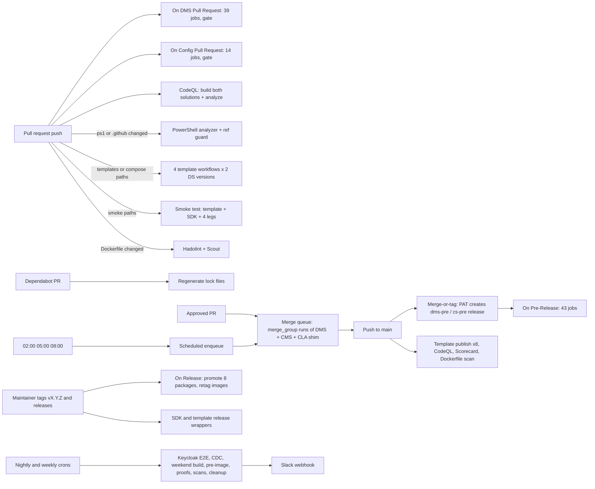
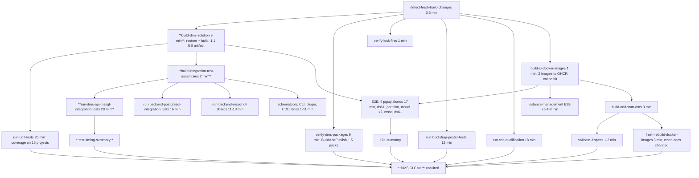
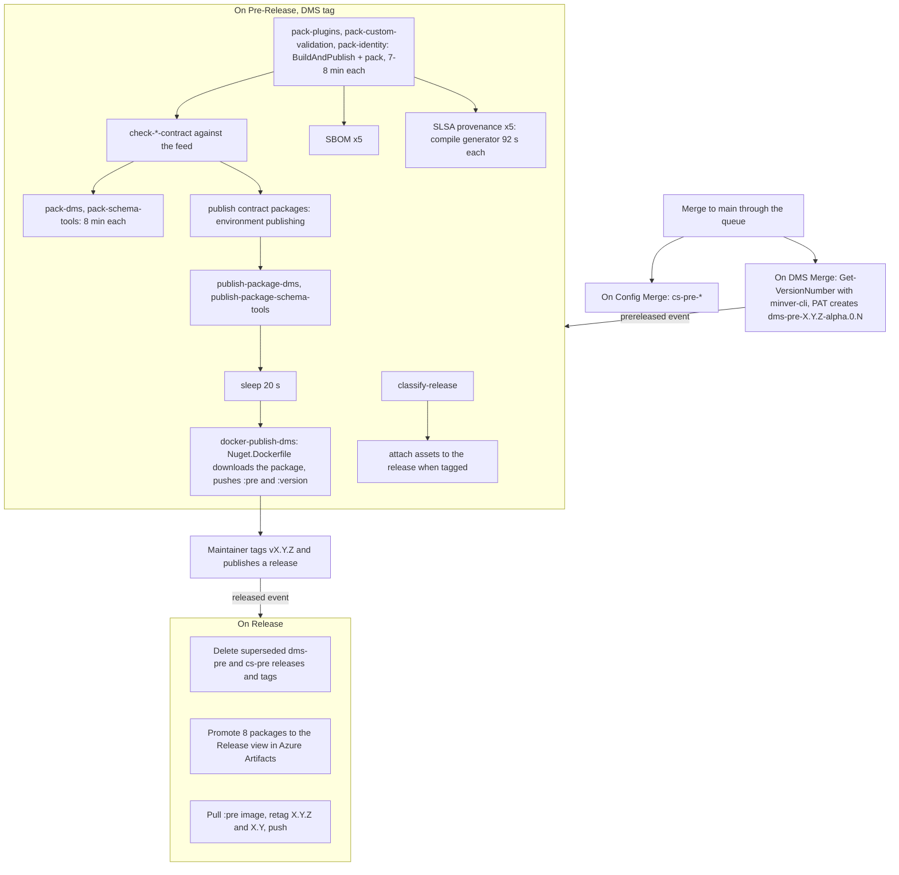

# Data-Management-Service: CI/CD Review (concise)

**Audience:** senior DevOps engineer, new to this repo, coming from GitLab CI; the DMS development team; the Director of Software Engineering
**Status:** DRAFT for team review. Proposals only. Nothing in the repo was changed.
**Context:** Jira DEVOPS-157 (epic DEVOPS-154). In DEVOPS-155 (ODS-Admin-API) and DEVOPS-156 (Ed-Fi-AdminApp) this repo was the *reference* for good patterns. Here it is the *subject*: the most mature and largest pipeline in the group, so the question is complexity, cost and maintainability, not missing basics.
**Long version:** [ci-workflow-review-detailed.md](./ci-workflow-review-detailed.md) | **Companions:** [ci-executive-brief.md](./ci-executive-brief.md), [dockerfile-review.md](./dockerfile-review.md), [workflow-structure-review.md](./workflow-structure-review.md)
**Data:** 4,274 workflow runs (2026-10-13 to 2026-11-12, 30 days) read with `gh`, of which 3,265 completed with a result; job and step timings of 825 runs; the error lines of 142 of the 210 failed runs; a static check of the 36 workflow files; rulesets, environments, caches, releases, Docker Hub tags and the OpenSSF Scorecard from public APIs; a read of every workflow, action, Dockerfile, `eng/ci` script and CI document; a local restore and build of both solutions on a clone outside the working tree (Apple M1 Pro, 10 cores, .NET SDK 10.0.404). Analysis against `main` at `38c758539` (2026-11-12).

---

## 1. Bottom line

1. **The pipeline is complete and well engineered, and it is expensive to run and to change.** A full DMS pull-request run is **48 min median** (p90 55) across **49 jobs and about 400 runner-minutes**; the merge queue repeats it (48 min, 410 runner-minutes) for every merge. The repo consumed about **292,000 runner-minutes in 30 days** (about 9,700 per day); the two DMS PR events alone are 56%, pull requests of all kinds 68%.
2. **Three builds of the same commit could be one.** CodeQL rebuilds both solutions under its tracer on every C# PR (**38 min of a 41-min job**, 250 PR runs); the Config PR workflow builds its solution in each of 5 jobs (3 min each) instead of sharing output like DMS does; the release builds the package a third time and ships an image built from the downloaded package, not the tested one.
3. **The critical path is the MSSQL API integration lane (28 min) after the 9-min build, then the gate.** Unit tests take **23 min** (coverage on 15 projects), the CDC contract lane 18 min, each E2E shard about 17 min. Nothing waits on runners: job queue time median 3 s, p90 37 s; but 177 jobs waited more than 2 minutes, all inside the 45-job fan-out, which is the only sign of a concurrency ceiling.
4. **Failures are mostly real code or test problems, not infrastructure.** DMS PR runs fail 16% of the time (47 of 290), Config 8%; bot PRs are not the problem here (3 of 16 DMS bot runs). The notable non-code causes: **18 of 19 prerelease failures are the contract check refusing to republish `EdFi.Api.CustomValidation 1.0.0` with changed documentation**, which also skipped the DMS package and image publish in those runs (none of the 18 affected versions, from `8.1.0-beta.0.1.34` on 2026-10-20 to `8.1.0-beta2.22`, has a Docker Hub tag; the last beta prerelease image is `.32`); the weekend Visual Studio build failed 3 of 4 times on Windows path length (fixed on 2026-11-09, #1451); one Config integration assertion (`JobScheduleMaterializeResult+SkippedActiveJob`) failed on three runs across two days; Dependabot compose bumps fail a Pester pin-parity test (7 of 10 bot PRs closed unmerged).
5. **Security is ahead of the siblings on paper and behind on settings.** Scorecard 8.3; CodeQL, Scout, SBOM, SLSA provenance, template signing, environment-scoped tokens and a ref-injection guard all exist. But the three environments have **no protection rules** (the setup in `docs/CI-PUBLISHING-CREDENTIALS.md` is pending, DMS-1647 to DMS-1649), the containers **run as root**, base images are bumped by hand (no Dependabot `docker`), and three `@main` references include the required BIDI check.
6. **Housekeeping is cheap and visible:** two workflows can never run (`after-pullrequest.yml` subscribes to a name that does not exist; `on-issue-opened.yml` 0 runs), four registered workflows have no file, `copilot-setup-steps.yml` runs on every prerelease tag (602 runs), the Actions cache is at 8.96 of 10 GB with 7.1 GB from one PR ref, only 3 of about 180 jobs have a timeout, and `on-prerelease.yml` has no `concurrency`.
7. **The roadmap (section 6) prefers removing and merging over adding:** delete dead workflows, stop the duplicate builds, extract the eight E2E copies and the eight prerelease chains into reusable pieces, finish the environment setup, and export the DMS patterns the other repos were told to copy.

---

## 2. Key terms (GitLab equivalent in brackets)

| Term | Meaning here |
|---|---|
| **Workflow / job / step** | A YAML file in `.github/workflows/` (about a pipeline file), a unit that runs on one runner VM (a job), and a command or packaged action inside it. No stages: order jobs with `needs:`. This repo has 36 files, 15,239 lines, about 180 jobs. |
| **Runner** | The VM that runs a job. Here GitHub-hosted `ubuntu-latest` (24.04) everywhere, plus `ubuntu-24.04` on two scan jobs and `windows-2025-vs2026` on the weekend Visual Studio build. [shared SaaS runner] |
| **`GITHUB_TOKEN`** | Per-run token with the permissions set by `permissions:`. A push or release created with it does **not** start other workflows, which is why a PAT creates the prereleases. [`CI_JOB_TOKEN`] |
| **Merge queue / `merge_group`** | GitHub builds a temporary merge commit per queued PR and runs the workflows that listen to `merge_group`; the ruleset merges when the required checks pass. [merge trains] |
| **Gate job** | A job with `needs:` on every other job and `if: always()` that fails unless each result is `success` or `skipped`. It is the single required check (`DMS CI Gate`, `Config CI Gate`). |
| **Change categories** | A PowerShell module (`eng/ci/dms-change-categories.psm1`) that turns the PR diff into flags (`dms_relevant`, `backend_mssql_relevant`, ...) that every job's `if:` reads. Replaces `paths:` so the gate still reports. [`rules: changes:`] |
| **Reusable workflow** / **composite action** | A whole job graph called with `uses:` (`workflow_call`) / a bundle of steps. Here: 3 reusable workflows (templates, SDK), 4 composite actions. [`include:` component / `!reference`] |
| **`concurrency`** | Group of runs where a new run can cancel an older one. On 12 of 36 workflows. [`interruptible` + auto-cancel] |
| **Actions cache vs BuildKit cache vs GHCR CI images** | `actions/cache` stores files (NuGet packages, 10 GB limit). BuildKit layer cache can live in that store (`type=local`/`gha`) or in a registry. Here the two CI images are built once per PR and pushed to **GHCR by commit SHA**, with a registry cache tag written only by non-PR runs. |
| **Build output artifact** | `build-dms-solution` uploads `bin/` and `obj/` of the whole solution (about 1.1 GB) and 11 jobs download it, so they do not compile again. |
| **Dependabot** | GitHub's bot for dependency PRs: `nuget` (weekly, cooldown 5 to 14 days) and `docker-compose` (grouped). No `docker` or `github-actions` ecosystem. [Renovate] |
| **NuGet lock file / CPM** | `packages.lock.json` per project (66 files), `dotnet restore --locked-mode` as a PR gate and in the Docker builds; versions centralized in `src/Directory.Packages.props` (95 packages). |
| **Pre-release and release** | Every merge to `main` creates a GitHub pre-release (`dms-pre-X.Y.Z-alpha.0.N` or `cs-pre-*`) that triggers `on-prerelease.yml`; a maintainer tags `vX.Y.Z` for a release and `on-release.yml` promotes the packages and retags the images. |
| **Contract packages** | `EdFi.Api.Plugins`, `EdFi.Api.CustomValidation`, `EdFi.Api.Identity`, `EdFi.Api.Secrets`: separately versioned NuGet packages whose publish is guarded by a "contract check against the feed" (refuses to republish a changed package under the same version). |
| **SBOM / SLSA provenance / attestation** | SBOM: component list (SPDX). Provenance: signed statement of how a package was built (SLSA 3 through a fork of `slsa-github-generator`, 12 calls). Template packages are additionally signed with a key in the `template-attestation-signing` environment. |
| **Environment** | A named deployment target with its own secrets and optional reviewers and branch rules. Here `publishing`, `release-automation`, `copilot`; none has rules yet. [protected environment] |
| **CodeQL / Scout / Scorecard / BIDI** | SAST for C#; image CVE scan; OpenSSF supply-chain score (8.3); scan for hidden bidirectional Unicode (a required check through `Ed-Fi-Actions`). |
| **Pester** | PowerShell test framework. 25 test files under `eng/ci/tests` lint the workflows themselves (credential scope, ref injection, CI-budget wiring). |

---

## 3. How it works today

**36 workflows (32 files run; see the structure review for the full event map):**

| Group | Files | Trigger | Does | Time (median) |
|---|---|---|---|---|
| DMS PR | `on-dms-pullrequest` | PR to `main`, merge queue, manual | 39 jobs: detect, BIDI, Pester, lock files, packages, build, unit, 8 integration lanes, CDC contract, 5 E2E variants, 3 instance-management E2E, spec validation, fresh rebuild, timing summary, gate | 48 min, 400 runner-min |
| CMS PR | `on-config-pullrequest` | same | 14 jobs: detect, BIDI, lock files, parity Pester, tools, unit, integration, 3 E2E matrices, secrets contract, fresh rebuild, gate | 28 min, 103 runner-min |
| Static | `codeql-analysis`, `powershell-analysis`, `on-pullrequest-dockerfile` | PR and `main`, path-filtered | CodeQL C# (with a full build), dependency review; PSScriptAnalyzer + ref guard; Hadolint + Scout | 41 min; 1 min; 3 min |
| Packages on PR | 4 template wrappers, `scheduled-smoke-test` | PR (about 35 paths), `main`, `v*`, release | Build minimal and populated templates for MSSQL and PostgreSQL x 2 data standards, with SBOM, provenance, signing; smoke test with the SDK | 11 to 24 min; 42 min |
| Merge and release | `on-*-merge-or-tag`, `on-prerelease`, `on-release`, `Pkg EdFi.Api.*` | push `main`, `release` | PAT creates prerelease; 43-job pack/SBOM/provenance/contract/publish/Docker chain; promotion and retag on `v*` | 1 min; 22 min (DMS) / 15 min (CMS); 7 min |
| Queue | `on-merge-group-cla`, `scheduled-merge-queue-enqueue` | `merge_group`, 3 crons | CLA status shim; overnight enqueue with the PAT | seconds |
| Scheduled | `nightly-keycloak-e2e`, `nightly-cdc-qualification`, `dms-weekend-build`, `scheduled-pre-image-test`, `scheduled-secret-resolution-proof`, `scheduled-stock-plugin-proof`, `analyze-docker-images`, `cleanup-dms-ci-ghcr-images`, `scorecard` | crons | Keycloak E2E (4 shards); CDC suites (up to 18 jobs, 110 min); Visual Studio build + E2E; `:pre` image E2E; two proofs; weekly scan; GHCR cleanup; Scorecard | 28; 110; 98; 60; 7; 7; 1; 0.5; 1 min |
| Dependabot | `dependabot-lock-file` | bot PRs | Regenerates lock files with `GITHUB_TOKEN` | seconds |
| Dead or noisy | `after-pullrequest`, `on-issue-opened`, `copilot-setup-steps` | never / every tag | 0 runs; 0 runs; 602 runs | n/a |

**What fires when:**



**A DMS pull request (critical path in bold):**



**From merge to released package:**



**Versions:** `package-helpers.psm1` installs `minver-cli` (unpinned) and computes `dms-vX.Y.Z-alpha.0.N` from the newest `v*` tag. Prereleases are automatic (52 DMS + 38 CMS in 30 days, 91 prerelease runs); a release is a manual tag (`v8.1.0` on 2026-11-05, the only one in the window). Packages live in **Azure DevOps Artifacts**, images on **Docker Hub** (`edfialliance/ed-fi-api`, `ed-fi-api-configuration-service`, amd64 only), SBOM and provenance on the GitHub release when tagged.

---

## 4. Evidence

### 4.1 Reliability and speed (30 days, completed runs)

| Workflow (event) | Runs | Median | p90 | Failures | Cancelled | Runner-min (30 d) |
|---|---|---|---|---|---|---|
| On DMS Pull Request (pull_request, full runs) | 290 | 48.2 min | 54.8 min | 47 (16%) | 50 | 125,700 (43%) |
| On DMS Pull Request (merge_group) | 93 | 48.3 min | 51.7 min | 5 (5%) | 3 | 38,100 (13%) |
| On Config Pull Request (pull_request, full runs) | 314 | 28.1 min | 29.7 min | 25 (8%) | 26 | 34,200 (12%) |
| On Config Pull Request (merge_group) | 93 | 27.7 min | 28.6 min | 11 (12%) | 0 | 9,800 (3%) |
| CodeQL (pull_request) | 224 | 41.3 min | 46.1 min | 17 (8%) | 26 | 9,500 (3%) |
| Scheduled Smoke Test (pull_request) | 80 | 42.4 min | 44.5 min | 8 (10%) | 17 | 12,100 (4%) |
| 4 template workflows (pull_request, each) | 134 to 137 | 11 to 24 min | 16 to 27 min | 6 to 8 | 9 to 11 | 17,800 (6%) together |
| 4 template workflows (push to `main`, each) | 81 | 12 to 23 min | 16 to 26 min | 2 to 5 | 0 | 10,700 (4%) together |
| On Pre-Release (release) | 90 | 21.6 min (dms) / 15.1 min (cs) | 23.1 / 22.7 min | 19 (21%) | 0 | 3,300 (1%) |
| Nightly CDC Qualification (schedule) | 31 | 110 min | 112 min | 6 (19%) | 0 | 14,400 (5%) |
| Nightly Keycloak DMS E2E (schedule) | 27 | 27.6 min | 29.2 min | 1 | 0 | 2,600 (1%) |
| DMS Weekend Build (schedule) | 4 | 97.5 min | 103 min | 3 | 0 | 850 |
| Scheduled pre Image Tests (schedule) | 4 | 59.8 min | 65.4 min | 1 | 0 | 540 |
| On Release (release) | 1 | 7.1 min | n/a | 0 | 0 | 7 |

**Total: about 291,700 runner-minutes in 30 days (about 9,700 per day).** By event: pull requests 68%, merge queue 16%, schedules 7%, pushes to `main` 5%, releases 1%. Measured on 460 runs with job data and extrapolated to the rest from per-workflow medians.

**Bot versus human:** DMS PR fails for 3 of 16 Dependabot runs and 44 of 274 human runs (16%); Config 2 of 16 and 23 of 298 (8%). 18 DMS and 17 Config PR runs were re-run by hand (attempt > 1). Dependabot opened 10 PRs in 60 days: 2 NuGet bumps merged, 7 of 8 compose bumps closed unmerged (they fail the Pester test "pins the same Keycloak image by tag and digest in both compose files").

| Failure cause (from the error lines of 142 failed runs) | Runs | Where |
|---|---|---|
| Contract check refuses to republish `EdFi.Api.CustomValidation 1.0.0`: "already published and documentation differs from what was published"; the publish and Docker jobs that depend on it are then **skipped**, so those merges produced no prerelease package or image (Docker Hub confirms it: none of the 18 affected `dms-pre` versions has a tag; the last beta image is `8.1.0-beta.0.1.32`, the next is `8.1.0` on 2026-11-05) | 18 of 19 | On Pre-Release (2026-10-20 to 11-03) |
| Test assertion in a lane (unit, E2E authorization denials, integration): real failures on feature branches; one assertion repeated on 3 runs over 2 days (`JobScheduleMaterializeResult+SkippedActiveJob`) and one unit test (`It_warns_naming_the_reconciler...`) look timing-related | about 60 (Config `Run Integration Tests` 17, Config E2E 21, DMS unit 9, DMS packages 8, DMS E2E and build lanes) | DMS and Config PR |
| Compiler error under `TreatWarningsAsErrors` (CS, analyzer or NU audit) | 18 | DMS PR, CodeQL, smoke, templates, weekend |
| Windows: "The specified path, file name, or both are too long", `MSB3541`, `MSB3021` in the Visual Studio build (3 of 4 weekend runs; #1451 on 2026-11-09 moved to 64-bit MSBuild and the next run passed) | 3 | DMS Weekend Build |
| CDC qualification: `controller-unit` 2 of 4,756 failed on a merge-queue run; nightly `Postgresql-runbook-setup: Failed, passed=0, required=2` (environment) | 16 | DMS PR (10), nightly CDC (6) |
| Pester test failures, including the pin-parity test on Dependabot compose PRs | 6 | DMS and Config PR |
| `dotnet-install` 409 from the .NET CDN (external, one afternoon) | 2 | Config PR (manual) |
| Smoke: "Configuration Service did not become healthy within 300 seconds", then `openapi-generator` `java.lang.OutOfMemoryError` | 2 | Scheduled Smoke Test |
| SLSA generator `final` step exit 27 | 1 | Template PR |
| No error line captured (cancelled mid-run or external) | 14 | various |

**Where DMS PR time goes (medians of successful jobs):** `build-dms-solution` 9.1 min (`Build` 346 s, `tar -czf` of the output 127 s); `run-unit-tests` 26 min (`Run Unit Tests` 1,381 s with the XPlat coverage collector over 15 unit projects); `run-dms-api-mssql-integration-tests` 28 min (tests 1,712 s); `run-backend-postgresql-integration-tests` 16 min; `run-backend-mssql` 4 shards of 11 to 13 min; `run-cdc-qualification` 18 min (Pester and unit suites, 1,045 s); `run-bootstrap-pester-tests` 12 min (662 s of Pester); `verify-dms-packages` 9 min (a second `BuildAndPublish`, 391 s); each PostgreSQL E2E shard 17 min (E2E 1,018 s; shard 1 adds the 378 s token-contract E2E); SQL Server E2E 16 to 18 min; instance-management E2E 4 to 8 min; `build-ci-docker-images` 0.7 min (both images are cache hits); `build-and-start-dms` 3 min. The critical path is detect -> build (9) -> integration assemblies (2) -> MSSQL API integration (28) -> summary -> gate: about 40 min plus overhead.

**Where a CMS PR goes:** `run-integration-tests` 27 min (`Build` 187 s + tests 1,328 s), `run-unit-tests` 24 min (`Build` 179 s + tests 1,244 s), each E2E leg 5 to 7 min after a 209 s `Build`; five jobs build the solution independently.

**Where CodeQL goes:** `Build` 2,283 s (both solutions under the tracer) + `Perform CodeQL Analysis` 342 s. **Where a prerelease goes:** each `pack-*` 7 to 8 min (a `BuildAndPublish` per package family, 5 for DMS tags), contract check 0.5 to 3.4 min, SBOM 0.5 min, provenance 1.8 min (92 s to compile the generator), publish 0.5 min, Docker publish 1.4 min (20 s of which is `sleep`).

**Local build (clone, M1 Pro):** `dotnet restore --locked-mode` cold 193 s, warm 3 s; `dotnet build -c Release --no-restore` cold 194 s (includes the first compiler-server start and the plugin fixture publish), no-op 25 s, after touching one `Core` file 11 s; full rebuild 88 s with analyzers and 41 s with `-p:RunAnalyzers=false`. In the rebuild performance summary `CoreCompile` sums to 210 s with analyzers and 41 s without (50 projects; `SonarAnalyzer.CSharp` and `Microsoft.CodeAnalysis.CSharp.CodeStyle` in all three `Directory.Build.props`). The CI `Build` step (346 s on a 4-core runner, restore included) is consistent with this.

**Runners and queue:** all Linux except two `ubuntu-24.04` pins and the `windows-2025-vs2026` weekend job (12 min per run, 58 Windows minutes measured). Job queue time over 2,921 jobs: median 3 s, p90 37 s, p99 628 s, max 810 s; the 177 jobs that waited more than 2 min were in the DMS PR fan-out (MSSQL shards, spec validation, fresh rebuild), so capacity is only tight when several 45-job runs overlap.

**Actions cache:** 110 entries, **8.96 GB of 10 GB**; 7.12 GB belong to `refs/pull/1452/merge` (three 2 GB `Linux-buildx` entries from the per-job image-build fallback plus 99 BuildKit blobs), `main` holds 1.4 GB including the 1.1 GB NuGet entry every job restores.

### 4.2 Security baseline

| Item | Status | Evidence |
|---|---|---|
| OpenSSF Scorecard | **8.3**; 0/10 on `Token-Permissions` (top-level `contents: write` in the template wrappers), 8/10 pinning and branch protection, 10 elsewhere (SAST, signed releases, vulnerabilities, CI tests) | `api.scorecard.dev`, 2026-11-12 |
| CodeQL | C# on PR and `main`, path-filtered; **builds both solutions** (41 min) | `codeql-analysis.yml` |
| Dependency review | Default settings, inside the CodeQL job | same |
| NuGet | CPM, 66 lock files, `--locked-mode` in PR, Docker and release builds; package source mapping (`EdFi.*` only from the Ed-Fi feed); `TreatWarningsAsErrors` makes NU audit warnings fail the build (DMS-1608 fixed such a failure) | `src/nuget.config`, `Directory.Build.props` |
| Dependabot | `nuget` weekly with cooldown, `docker-compose` grouped; **no `docker`, no `github-actions`** | `.github/dependabot.yml` |
| Images | Base images pinned by digest, bumped by hand (last: DMS-1608, Oct 2026); Hadolint + Scout on PR and weekly; **no `USER`** (root); SBOM and provenance for packages only, not images | Dockerfiles, `dockerfile-review.md` |
| Supply chain | SBOM (sbom-tool) and SLSA 3 provenance for 8 package families and the templates; template packages signed; contract packages verified against the feed before publish | `on-prerelease.yml`, `build-*-template.yml` |
| Secrets and environments | Publishing tokens named only in `publishing` and `release-automation` jobs; `ReleasePublishingCredentials.Tests.ps1` enforces it; `Test-WorkflowRefInjection.ps1` refuses ref expressions in `run:`; **environments exist with 0 protection rules and no branch policy; no tag ruleset** (setup steps 1 to 4 of the credentials doc pending) | `gh api .../environments`, `.../rulesets` |
| Pinning | All third-party actions by SHA except `repository-scanner.yml@main` (x2, the required BIDI check), `powershell-analyzer.yml@main`, and the SLSA fork `@v2.0.0`; `minver-cli` installed unpinned at run time | `grep uses:` |
| Alerts | Code-scanning, Dependabot and secret-scanning alerts not readable (403/404) | limits |
| `SECURITY.md` | Correct for this repo (private reporting, CodeQL, Scorecard) | file |

### 4.3 Static check (252 findings, triaged)

`ci_check.py` over the 36 files: **211 cost** (177 jobs without `timeout-minutes`, 33 uploads without `retention-days`, 1 Windows runner), **38 speed** (24 `fetch-depth: 0`, of which the 10 in `on-prerelease.yml` and the merge workflows are needed by MinVer; 9 "no concurrency", 5 "no paths"), **3 safety** (the three `@main` references). Valid: the timeouts, the retention gaps, the `@main` pins, `concurrency` on the prerelease and release workflows. False positives: `fetch-depth: 0` where MinVer or `git diff` need history; "no paths" on workflows that use change detection on purpose; `concurrency` on `workflow_call` files (callers set it).

---

## 5. Shared templates (how roadmap items fit)

DMS is the source, not the consumer. `Ed-Fi-Actions` has `repository-scanner.yml` and `powershell-analyzer.yml` (both used here, both `@main`) and nothing else reusable. The ODS-Admin-API and AdminApp reviews already proposed a shared `dotnet-build-test`, `codeql-csharp`, `dependabot-lock-file`, `docker-image-analysis`, `release-pack-publish` and two composite actions; most of those patterns exist here in their most mature form.

| # | Shared piece (in `Ed-Fi-Actions`) | Type | Source in DMS | Consumers |
|---|---|---|---|---|
| 1 | `dependabot-lock-file` | Reusable workflow | `dependabot-lock-file.yml` + `docs/NUGET-LOCK-FILES.md` | ODS-Admin-API (S1) |
| 2 | `pull-ci-images`, `start-mssql-test-container`, `start-postgresql-test-container`, `export-database-container-diagnostics` | Composite actions | `.github/actions/*` | both siblings |
| 3 | `ci-gate` pattern + `change-categories` | Composite action + doc | `dms-ci-gate`, `eng/ci/dms-change-categories.psm1` | both siblings (L3) |
| 4 | `ghcr-ci-images` (build once by SHA, cleanup, cache verification) | Reusable workflow | `build-ci-docker-images`, `cleanup-dms-ci-ghcr-images.yml` | both siblings (M3/M4/L5) |
| 5 | `workflow-lint` (ref-injection guard, credential-scope test, timeout guard) | Reusable workflow | `eng/ci/Test-WorkflowRefInjection.ps1`, `eng/ci/tests/*` | all repos |
| 6 | `e2e-lane` | Reusable workflow | to be extracted from the 8 E2E copies (M6) | DMS first, then AdminApp |
| 7 | `pack-attest-publish` | Reusable workflow | to be extracted from `on-prerelease.yml` (M18) | DMS, ODS-Admin-API, AdminApp (L4 there) |
| 8 | `test-timing-summary` | Composite action | `eng/ci/summarize-test-timings.ps1` | both siblings (S16/S18) |
| 9 | Environment-scoped publishing model | Doc + verification tests | `docs/CI-PUBLISHING-CREDENTIALS.md` | both siblings (M13) |

**Guardrails:** pin callers to a commit SHA (never `@main`), version `Ed-Fi-Actions` with tags, keep `permissions:` in the caller, pilot each piece in one sibling before the second. Suggested order: 1, 2, 5, 8 (ready today), then 3, 4, then 6, 7 (after the DMS refactor).

---

## 6. Roadmap

Effort: **S** = hours to 1 day, **M** = a few days, **L** = weeks. IDs follow the ODS-Admin-API and AdminApp reviews where the theme is the same (see section 7 of the detailed review). Every item states what it costs in review and maintenance, not only what it saves. "Innovation" rows are optional experiments. Preference: remove, merge or simplify before adding.

### 6.1 Short term (days, low risk)

| ID | Area | Item | Why / evidence | Effort |
|---|---|---|---|---|
| S19 | Hygiene | **Clean up unused workflows:** delete `after-pullrequest.yml` (subscribes to "On Pull Request", a name that does not exist; 0 runs ever) and the two `event_file` jobs that feed it (24 and 10 `needs` entries); delete `on-issue-opened.yml` (0 runs ever); delete the run history of the four ghost workflows (`EdFi.Dms.Populated.Template.PostgreSQL`, `backfill-document-cache-admin`, `config-database-topology-matrix`, `on-mssql-template-pullrequest`); add `branches: [main]` to `copilot-setup-steps.yml` (602 runs, one per prerelease tag) | Dead code in the two largest files; ghost entries mislead newcomers. Cost: one PR, nothing to maintain | S |
| S6 | Hygiene | `timeout-minutes` on all jobs (p90-based: E2E 40, integration 45, unit 40, pack 20, CDC qualification keeps 120); `retention-days` on the 33 uploads without one; `concurrency` (no cancel) on `on-prerelease.yml` and `on-release.yml` | 177 jobs on the 360-min default; the queue check timeout is 240 min; two quick merges run two prereleases into the same `:pre` tag. Cost: about 180 one-line edits; add a Pester guard so it stays true | S |
| S7 | Security | Pin `repository-scanner.yml` and `powershell-analyzer.yml` to a SHA (ask `Ed-Fi-Actions` for release tags); pin `minver-cli` (`dotnet tool install --global minver-cli --version x.y.z`); add a Dependabot `github-actions` ecosystem (grouped, weekly) to keep the 400+ SHA pins fresh | The required BIDI check follows a moving branch; the version tool is unpinned in the release path. Cost: one grouped PR per week | S |
| S20 | Security | **Finish the environment setup** from `docs/CI-PUBLISHING-CREDENTIALS.md`: required reviewers and branch/tag policy on `publishing`, branch policy on `release-automation`, the two tag rulesets, then remove the repository and organization copies of the four secrets; run verification checks 1, 5, 6, 7 | Environments exist with 0 rules, so the YAML move protects nothing yet (DMS-1647 to DMS-1649). Cost: settings only; a reviewer approves each publish afterwards (decide who) | S (admin) |
| S21 | Speed | **CodeQL `build-mode: none`** for C# and move dependency review to its own job; measure the alert delta on one PR | `Build` is 38 of 41 min, 250 PR runs and 56 `main` runs a month, cancelled 26 times. Cost: two lines; CodeQL's coverage of generated code may change, hence the trial | S (trial) |
| S22 | Cache | Stop the per-job image-build fallback from writing `Linux-buildx-*` entries on PR refs (`cache-to` only on `main`, or drop `actions/cache` there and rely on the GHCR registry cache) | 7.1 GB of the 10 GB cache from one PR; evicts `main`'s 1.1 GB NuGet entry. Cost: 8 jobs edited once (or removed in M6) | S |
| S23 | Speed | `tar` the build output without gzip (or `zstd -1`) since `upload-artifact` already runs with `compression-level: 0`; measure | `Archive DMS Build Output` is 127 s on the critical path and the 11 downloads spend 14 s each extracting | S (trial) |
| S1 | Reliability | **Contract packages:** when a contract package's declared version is already on the feed, make the check **skip** publish with a notice instead of **failing the run** (which also skips the DMS publish), and bump `EdFi.Api.CustomValidation` to 1.0.1 so the changed documentation ships | 16 of 19 prerelease failures; in those runs `publish-package-dms` and `docker-publish-dms` were skipped, so the merge produced no prerelease. Cost: a script change in `eng/verification/Invoke-ContractPublishCheck.ps1` plus a test | S |
| S2 | Reliability | **Dependabot compose PRs:** group the two compose directories so one PR bumps both pins, or relax the Pester parity test for bot PRs with a follow-up; decide who closes superseded bot PRs | 7 of 8 compose PRs closed unmerged; each one ran 9 workflows first. Cost: a `dependabot.yml` edit or a test edit | S |
| S3 | Reliability | Replace `sleep 20` in the two Docker publish jobs with a poll of the feed, add a bounded retry and the SHA-256 check to `Nuget.Dockerfile` (`dockerfile-review.md` DF4) | Timing race in the release chain; the computed hash is never verified. Cost: a few lines in two Dockerfiles and two jobs | S |
| S8 | Runners | Document the `ubuntu-24.04` pins and the `windows-2025-vs2026` label; pin the .NET SDK with a `global.json` (`rollForward: latestPatch`) now that every workflow says `10.0.x` | A runner image update changes the SDK under a green build; the weekend build failed 3 of 4 times on a Windows-only path-length issue. Cost: one file | S |
| S9 | Hygiene | `open-pull-requests-limit` on the `nuget` ecosystem; keep the cooldown | Fewer simultaneous bot runs (each bot push starts up to 9 workflows) | S |
| S10 | Security | **Add a Dependabot `docker` ecosystem** for the four Dockerfiles (weekly, grouped) | Base images bumped by hand; last two bumps were incident-driven. Cost: one grouped PR per week that runs the Dockerfile scan | S |
| S11 | Security | **Run the containers as a non-root user** (`adduser`, `USER`, `COPY --chown`) in the four Dockerfiles | Root inside the container; Kubernetes `runAsNonRoot` policies refuse the image. Cost: one E2E pass per image | S |
| S13 | Security | Configure `dependency-review-action` (`fail-on-severity: high`, license rules, PR comment) | Default settings today | S |
| S16 | Innovation | Extend the existing timing summary into a run-level `$GITHUB_STEP_SUMMARY` on the gate job: slowest lanes, failed jobs, runner-minutes of the run | The data is already produced per lane; one aggregate line per run makes cost visible | S |
| S17 | Innovation | Advisory AI failure digest: on a failed gate, post a short summary of `gh run view --log-failed` as a PR comment (failures here are spread over 49 jobs and long logs) | 84 of 142 failed runs showed only "exit code 1" at the `##[error]` level; the cause was deeper in the log | S-M |
| S18 | Innovation | CI health report: schedule the `gh` queries of this review (runner-minutes by event, median and p90 per workflow, failure causes, queue p99, cache usage) into a weekly summary | Baseline to prove the gains of M1, M6, M18 | S |
| S24 | Hygiene | Lint the workflows with `actionlint` and `zizmor` in the PowerShell analysis workflow (keep the Pester guards) | Catches unpinned refs, over-broad permissions and expression injection on every PR without custom code | S |
| S25 | Governance | Tighten the `main` ruleset: `dismiss_stale_reviews_on_push`, `required_review_thread_resolution`; confirm the repository Actions policy (403 for this account) | Readable ruleset shows both off | S (admin) |

### 6.2 Mid term (weeks)

| ID | Area | Item | Why / evidence | Effort |
|---|---|---|---|---|
| M1 | Speed | **Build the CMS solution once** (`build-config-solution` job + artifact) and share it with the unit, integration and E2E jobs, as DMS does; the DMS unit-test job can also drop its own `dotnet restore --locked-mode` (the lock gate already ran) | 5 builds of 3 min each per CMS PR; the integration job's 27 min includes a 3-min build. Cost: about 150 lines, copies a proven pattern | M |
| M2 | Speed | **Unit tests at 23 min:** profile the lane (coverage collector overhead, CsCheck property tests, the `EdFi.InstanceManagement.Tests.E2E` fixture tests run here); options: run coverage only on `main`, shard the 15 projects into 2 jobs, or `dotnet test --no-build` per project in parallel | Second-longest job; sits on a 26-min branch of the graph. Cost: one profiling PR, then a small split | M |
| M3 | Speed | **MSSQL API integration lane at 28 min (the critical path):** shard it like the backend MSSQL lane (4 shards of 11 to 13 min) with the same category mechanism | Takes about 15 min off the critical path if the fixtures shard cleanly. Cost: categories in the test project and one matrix | M |
| M4 | Speed | Move `run-cdc-qualification` (18 min, Pester plus unit suites) and `run-bootstrap-pester-tests` (12 min) partly to the nightly, keep a 2 to 3 min smoke subset on PRs, or shard them | Both run on PRs that touch broad paths; both are mostly CPU-bound script suites | M |
| M5 | Cost | **Templates on demand:** build-only on `main`, publish on `v*` tags and manual runs, unless the `pre` template feed has consumers; merge the four wrappers into one matrix workflow (M19) | 81 push runs x 4 workflows x 2 DS versions publish 8 signed packages per merge; 28,500 runner-min/month in template builds. Cost: an input change; consumers of `pre` templates must say so | S-M |
| M6 | Reuse | **Extract `e2e-lane.yml`** (reusable; inputs: engine, env file, filter, identity provider, shard, image refs) and call it with a matrix from both PR workflows; then an `integration-lane` composite action | 8 copies of a 200-line job in DMS and 3 in CMS; the image-build fallback alone is duplicated 8 times. Cost: the largest refactor here, done lane by lane with the timing summary as the regression check; Pester wiring tests updated | L |
| M7 | Reliability | Quarantine mechanism for timing-related tests (rerun failed tests once with `--blame-hang`, report flaky ones in the summary) and a fix for the two assertions seen repeating | 18 + 17 manual reruns a month; two repeating assertions. Cost: a test-runner flag and a list to review weekly | M |
| M8 | Security | Nightly vulnerability scan independent of PRs: `dotnet list package --vulnerable --include-transitive` on both solutions, OSV-Scanner on the 66 lock files, Scout on the published `:pre` images | PR-time scans see only changed files; the weekly image scan rebuilds from source instead of scanning what is published | M |
| M9 | Security | CodeQL `security-extended` for C#; add the `actions` language (workflow files) | Wider rules; the workflow YAML is 15,000 lines of code | S |
| M10 | Security | Attest the Docker images (`provenance: mode=max`, `sbom: true`, `actions/attest-build-provenance`) | SBOM and provenance stop at the NuGet packages | M |
| M11 | Security | NuGet signature verification (`signatureValidationMode=require`, trusted signers for nuget.org and the Ed-Fi feed) | Package source mapping exists; authenticity is not verified | M |
| M12 | Security | Vulnerability policy with SLAs and an owner; weekly report from the code-scanning API (needs read access for the reporting identity) | Alerts were not readable; no SLA is written down | M |
| M13 | Security | Replace the PAT: a GitHub App token for prerelease creation and the queue enqueue (`actions/create-github-app-token`), or create the prerelease from a `workflow_call` chain | Long-lived PAT in the release path, now environment-scoped but still a PAT | M |
| M14 | Innovation | Merge queue trial: `max_entries_to_build: 2 or 3` for a week, measure merges per day and rebuilds | Serial queue: one 48-min entry at a time; 93 entries a month | S (trial) |
| M15 | Innovation | Test impact analysis for the integration lanes: run only the lanes whose category changed (exists) **and** skip E2E shards whose feature files and step bindings did not change (`git diff` on `*.feature` and the steps project) | E2E is 8 of 49 jobs and about 120 runner-min per run; many PRs touch one area | M |
| M16 | Innovation | Dynamic matrix generation: one `plan` job emits the E2E and integration matrices from the change categories, so adding a lane is a data change | Replaces 39 hand-written `if:` expressions once M6 lands | M |
| M17 | Runners | Keep hosted runners; after M3 and M6, measure whether `ubuntu-latest-4-core`-class larger runners shorten the two longest lanes enough to pay for themselves (public repos: larger runners are billed) | Queue is fine; CPU-bound lanes (unit, MSSQL integration, CodeQL) might benefit; no claim without a trial | S (trial) |
| M18 | Reuse | **`pack-attest-publish.yml`** reusable workflow (or a matrix over package families) for `on-prerelease.yml` | 8 copies of a 5-job chain, 43 jobs, 2,718 lines; contract ordering becomes `needs` on the matrix job. Cost: one careful PR, dry-run with `workflow_dispatch` (exists) | M-L |
| M19 | Reuse | One template wrapper with a 4-leg matrix and one reusable `build-template.yml` with a `template_kind` input | 5 near-identical files, two 1,000-line reusables; path lists already drift | M |
| M20 | Docker | Remove the per-job image-build fallback (fork PRs get a `docker save` artifact from `build-ci-docker-images`) | 8 x 40 lines; see S22 and `dockerfile-review.md` DF7 | M |
| M21 | DX | `docs/CI.md`: the event map, what is required, how to read a red gate, how to reproduce each lane locally with `build-dms.ps1` and `build-config.ps1`; link it from the README | No document explains the 36 workflows; onboarding cost of a 15,000-line pipeline | S-M |
| M22 | .NET build | Analyzers: keep them on PRs but measure `-p:RunAnalyzers=false` in the lanes that only need binaries (`verify-dms-packages`, CodeQL if it still builds, prerelease `pack-*`); consider the `-graph` build and `UseSharedCompilation` defaults | Locally the rebuild takes 88 s with analyzers and 41 s without; `CoreCompile` 210 s vs 41 s. Cost: a property per lane; analyzers must still gate once per PR | S (trial) |
| M23 | Scheduled | Give each cron an owner and a purpose line; move the three Saturday 08:00 to 08:30 starts apart; make `notify-results` post a one-line summary with the failing suite, not only pass/fail; decide whether the 110-min nightly CDC qualification runs every night or on changed CDC paths plus weekly | 11 crons, Slack as the only sink; 3 of 4 weekend builds and 6 of 31 CDC nights failed and the failures were not visible outside Slack | S-M |

### 6.3 Long term (months, needs team decisions)

| ID | Area | Item | Why / evidence | Effort |
|---|---|---|---|---|
| L1 | Scope | Decide the fate of the weekend Visual Studio build: keep if the Windows developer experience is a product requirement; otherwise drop the Windows runner and keep the Saturday E2E on Linux | 3 of 4 failures were Windows path-length only; 12 Windows minutes a week | S |
| L2 | Release | **Release the tested artifact:** retag the GHCR CI image of the merge commit to Docker Hub (or build the published image from the CI publish output) and derive the packages from the same build; rethink prerelease-on-every-merge (90 in 30 days, 1 release) with a documented promotion step behind `publishing` | Today's release is the third build of the commit; `Nuget.Dockerfile` ships a different runtime layer than the tested image | L |
| L3 | Governance | After S20, make `publishing` approvals the release gate and write the promotion runbook (`docs/CI-PUBLISHING-CREDENTIALS.md` has the recovery part already) | Who may publish is a settings question today | S |
| L4 | Reuse | Export to `Ed-Fi-Actions` (section 5): lock-file workflow, the four composite actions, workflow-lint, gate pattern, then `e2e-lane` and `pack-attest-publish` | One owner per fix across three repos | L |
| L5 | Docker cache | Build the published image from the CI-built publish output (no third compile); multi-arch on native arm64 runners only if arm64 users exist | amd64-only today; see `dockerfile-review.md` DF11, DF12 | M-L |
| L6 | Runners | Stay on GitHub-hosted runners; do **not** adopt self-hosted runners on this public repo | Fork PRs would run code on your infrastructure | n/a |
| L7 | Security | Replace the `slsa-github-generator` fork with `actions/attest-build-provenance` (keyless OIDC) for packages, templates and images (DEVOPS-158 PoC) | 12 reusable calls, 92 s each to compile the generator; a fork pinned by tag | L |
| L8 | Security | Short-lived credentials everywhere: GitHub App instead of the PAT (M13), OIDC to Azure Artifacts if the feed supports it, Docker Hub token only in `publishing` | Fewer long-lived secrets | L |
| L9 | .NET build | One shared `src/Directory.Build.props` (lock files, analyzers, `TreatWarningsAsErrors`) imported by the three area props, so the `SetDMSAssemblyInfo` here-strings in the build scripts stop reproducing it; MSBuild `-graph` and `-m` defaults in `build-*.ps1` | The lock-file doc calls the duplicated props a maintenance hotspot; the build scripts regenerate them from strings | M |
| L10 | Innovation | Preview environments: deploy the PR's GHCR images to an ephemeral stack (compose on a runner, or a cloud sandbox) with a link in the PR | Reviewers and QA see the change without a local stack | L |
| L11 | Innovation | Paved-road pipeline for Ed-Fi .NET services, parameterized by repo, built from the pieces in section 5 | DMS is the first; ODS-Admin-API is the second consumer | L |
| L12 | Innovation | Agent-assisted CI maintenance: a scheduled agent that triages failed gates (S17), proposes timeout and pin updates, and keeps `docs/CI.md` in step with the workflows | Workflow churn is 62 commits and 25,000 added lines in 90 days; the maintenance load is the real cost | L |

---

## 7. What DMS does well and should be exported

- **Single required gate per product** (`dms-ci-gate`, `config-ci-gate`) with change detection that still reports, so required checks never hang on path filters. The ticket's hypothesis that DMS lacks a gate was wrong.
- **Build once per PR**: the 1.1 GB solution artifact feeds 11 jobs; CI images are built once by commit SHA, pushed to GHCR, pulled with jittered retry, cleaned daily with the cache tag protected and verified.
- **Lock-file automation with a documented recovery** (`docs/NUGET-LOCK-FILES.md`), the model the ODS-Admin-API review proposed copying.
- **Environment-scoped publishing with a written setup and verification plan** (`docs/CI-PUBLISHING-CREDENTIALS.md`), tested by Pester (`ReleasePublishingCredentials.Tests.ps1`); the same test idea covers ref injection (`Test-WorkflowRefInjection.ps1`) and the CI-budget wiring.
- **Resource-limited database containers** (memory caps, tmpfs) as composite actions; **test timing summaries** per lane and aggregate; **E2E sharding by category**; **contract checks** that stop a changed package from being republished under the same version (the failure mode in 4.1 is the check working; the response is the issue).
- **Merge queue with a CLA shim and an overnight enqueue script** that reads the required checks from the ruleset.
- **SBOM, SLSA provenance, template signing, Scout on PR and weekly, Scorecard 8.3, a correct `SECURITY.md`.**

## 8. What repeats in ODS-Admin-API and Ed-Fi-AdminApp (and what does not)

| Baseline finding (siblings) | Here | Verdict |
|---|---|---|
| Dependabot PRs fail a lock-file or install gate (64% of PR failures in ODS-Admin-API, 28% in AdminApp) | NuGet bot PRs pass (lock-file automation works, 2 of 2 merged); compose bot PRs fail a Pester pin-parity test (7 of 8 closed) | **Mostly solved; one new variant** (S2) |
| Bot PRs have no registry secrets | Not an issue: CI images come from GHCR with `GITHUB_TOKEN`; Scout uses a read-only identity | **Solved** |
| Pre-release timing race (`sleep 20`) | Same `sleep 20` and unverified `wget`, but the measured failures are the contract check, not the sleep | **Repeats in code, not in data** (S3, S1) |
| Half of each E2E job is image build and start-up, no cache | Images are prebuilt (0.7 min job, cache hits); E2E time is the tests themselves (17 min per shard) | **Solved here, export it** |
| 33 open Scout alerts from base images nobody refreshes | Alerts not readable; base images are bumped by hand (same gap, DMS-1608 was incident-driven) | **Repeats** (S10) |
| Dependabot `nuget`/`npm` only | `nuget` + `docker-compose`; no `docker`, no `github-actions` | **Repeats** (S7, S10) |
| No timeouts, no concurrency | 3 timeouts out of 180 jobs; `concurrency` on 12 of 36 (the PR ones) | **Half repeats** (S6) |
| `@main` references in the signed chain or required checks | 3 `@main` (two are the required BIDI check) | **Repeats** (S7) |
| CodeQL inside the PR workflow with a second build | Separate workflow, still a full build of both solutions (38 min) | **Repeats, bigger** (S21) |
| Pre-release on every merge, PAT-created, no gate | Same, with environments defined but unprotected | **Repeats** (S20, M13, L2) |
| Tested artifact is not the released artifact | Same (third build, `Nuget.Dockerfile`) | **Repeats** (L2) |
| Three near-identical E2E workflow files | Eight near-identical E2E jobs inside one file, five near-identical template wrappers | **Repeats, inside the files** (M6, M19) |
| Retired workflows still listed; never-run workflows | Four ghost entries, two never-run files, one tag-triggered noise workflow | **Repeats** (S19) |
| Rulesets: only BIDI and CLA required (AdminApp) | Both gates required, merge queue on | **Does not repeat** |
| 8.3 GB of 10 GB cache from PR refs (AdminApp) | 8.96 GB, 7.1 GB from one PR ref | **Repeats** (S22) |
| Containers run as a non-root user (ODS-Admin-API) | Root | **Worse here** (S11) |
| Unpinned tools at run time (Bruno, syft, minver) | `minver-cli` unpinned; `sbom-tool` installed at run time without a version | **Repeats** (S7) |
| New here | 49-job PR with a 48-min critical path and 400 runner-min, repeated by the queue; 23-min unit tests; contract-check failures skip the publish; 110-min nightly CDC qualification; weekend Windows build; 15,000 lines of workflow YAML with 62 commits in 90 days; template packages published on every merge | **New** |

---

## 9. Questions for the dev team

Each question has a read-only verification command and the result found (`R=Ed-Fi-Alliance-OSS/Data-Management-Service`). Some need admin rights and return 403; they are marked.

### 1. What hurts most day to day: the 48-minute PR, the second 48 minutes in the queue, reruns, or the release failures? What do you re-run by habit?

```bash
gh run list -R $R --workflow on-dms-pullrequest.yml --limit 300 --json conclusion,attempt,event -q '[.[]|select(.event=="pull_request")]|group_by(.conclusion)|map("\(.[0].conclusion) \(length)")|.[]'
gh run list -R $R --workflow on-dms-pullrequest.yml --limit 300 --json attempt -q '[.[]|select(.attempt>1)]|length'
```
**Found:** 243 success, 47 failure, 50 cancelled, 145 skipped (drafts) in 30 days; 18 runs re-run by hand. Median full run 48.2 min, queue run 48.3 min.

### 2. Is the contract check failing the whole prerelease intended? Who bumps a contract package's version when its documentation changes?

```bash
gh run list -R $R --workflow on-prerelease.yml --status failure --limit 20 --json databaseId,createdAt,displayTitle
gh run view <id> -R $R --log-failed | grep -A4 'Invoke-ContractPublishCheck'
grep -n 'needs' -A4 .github/workflows/on-prerelease.yml | grep -B1 -A3 'publish-package-dms:'
```
**Found:** 18 of 19 failures: "EdFi.Api.CustomValidation 1.0.0 is already published and documentation differs from what was published". `publish-package-dms` needs the three contract publishes, so in those runs the DMS package and image publish were skipped; Docker Hub has no tag for any of the 18 affected versions (`8.1.0-beta.0.1.34` to `8.1.0-beta2.22`).

### 3. Was CodeQL `build-mode: none` tried? Why does CodeQL build both solutions when the PR workflows already build them?

```bash
git log --oneline -S 'build-mode' -- .github/workflows/codeql-analysis.yml
gh run view <codeql-run-id> -R $R --json jobs -q '.jobs[].steps[]|select(.name=="Build")|{startedAt,completedAt}'
```
**Found:** no commit mentions `build-mode`; `Build` step median 2,283 s, analysis 342 s, 250 PR runs in 30 days.

### 4. Why do unit tests take 23 minutes? Is coverage needed on every PR, and are the CsCheck property tests and the instance-fixture tests meant to run here?

```bash
gh run view <dms-pr-run-id> -R $R --json jobs -q '.jobs[]|select(.name=="Run Unit Tests")|.steps[]|select(.name|test("Unit Tests|Coverage"))|{name,startedAt,completedAt}'
cat eng/ci/coverlet.runsettings | grep -E 'Format|Exclude'
find src -name '*.Tests.Unit.csproj' | wc -l
```
**Found:** `Run Unit Tests` 1,381 s median (33 runs), coverage report 9 s; 15 unit projects; XPlat collector with cobertura format.

### 5. Can the MSSQL API integration lane be sharded like the backend MSSQL lane? What blocked it?

```bash
grep -n 'MssqlCiShard\|shard-category' .github/workflows/on-dms-pullrequest.yml | head
gh run view <dms-pr-run-id> -R $R --json jobs -q '.jobs[]|select(.name|startswith("Run DMS API MSSQL"))|{name,startedAt,completedAt}'
```
**Found:** backend MSSQL runs in 4 shards (11 to 13 min each); the API MSSQL lane is one job of 28 min and is the critical path.

### 6. Who consumes the template packages published on every push to `main`? Could they publish on tags only?

```bash
gh run list -R $R --workflow EdFi.Api.Populated.Template.MsSql.yml --event push --limit 10 --json conclusion,displayTitle
grep -n 'publish_package' ".github/workflows/EdFi.Api.Populated.Template.MsSql.yml"
```
**Found:** 81 push runs per template workflow in 30 days, each publishing both DS versions (`publish_package: true` on `main`).

### 7. Environments: who will own the protection rules, the tag rulesets and the removal of the organization secrets (DMS-1647 to DMS-1649)?

```bash
gh api repos/$R/environments -q '.environments[]|"\(.name) rules=\(.protection_rules|length) policy=\(.deployment_branch_policy)"'
gh api repos/$R/rulesets -q '.[]|"\(.name) \(.target) \(.enforcement)"'
gh secret list -R $R                      # 403 without admin
gh api repos/$R/actions/organization-secrets   # 403 without admin
```
**Found:** `copilot`, `publishing`, `release-automation` with 0 rules and `null` policy; rulesets `cla`, `main`, `patch` (branch targets only); secret listings return 403.

### 8. Is running the containers as root a known decision (Kubernetes deployments, file permissions in `run.sh`)?

```bash
grep -n 'USER\|adduser' src/dms/Dockerfile src/config/Dockerfile src/dms/Nuget.Dockerfile src/config/Nuget.Dockerfile
```
**Found:** no `USER` instruction in any of the four files.

### 9. Prior experiments: larger runners, analyzers off in some lanes, sharding the unit tests, merge queue batch size, `paths:` filters, reusable E2E? What happened?

```bash
git log --since=2026-05-01 --format='%h %cs %s' -- .github/workflows/on-dms-pullrequest.yml | grep -iE 'shard|runner|cache|concurrency|analyz|matrix|reusable|budget' | head -20
gh api repos/$R/rules/branches/main -q '.[]|select(.type=="merge_queue")|.parameters'
```
**Found:** DMS-1474 introduced the CI-budget wiring (categories and the shared build output); the queue is `max_entries_to_build: 1`, `ALLGREEN`, squash; the `DMS-1330-ci-baseline` and `DMS-1330-ci-after` branches ran 6 manual comparison runs on 2026-10-14 (all failed; the experiment's subject is unknown to this review).

### 10. Which scheduled lanes are read, and by whom? What happened after the 3 failed weekend builds and the 6 failed CDC nights?

```bash
gh run list -R $R --workflow dms-weekend-build.yml --limit 6 --json createdAt,conclusion
gh run list -R $R --workflow nightly-cdc-qualification.yml --status failure --limit 10 --json createdAt
gh run view <weekend-run-id> -R $R --log-failed | grep -E 'error [A-Z]+[0-9]+|too long' | head -3
grep -l slackapi .github/workflows/*.yml | wc -l
```
**Found:** weekend failures on 10-17, 10-24, 10-31 with "path too long", `MSB3541`, `MSB3021`; success on 11-07 after #1451; CDC failures include `Postgresql-runbook-setup: Failed, passed=0, required=2`; seven workflows post to Slack, nothing else records the outcome.

### 11. Is the Windows Visual Studio build a product requirement (developers on Windows) or a legacy check?

```bash
git log --format='%h %cs %s' -- .github/workflows/dms-weekend-build.yml | head -5
grep -n 'runs-on' .github/workflows/dms-weekend-build.yml
```
**Found:** `windows-2025-vs2026`, 7 to 14 min per run; #1451 "Use 64-bit Visual Studio MSBuild" is the latest change.

### 12. Are arm64 images wanted (Apple Silicon developers, Graviton)? Is the `pre` Docker tag consumed by anyone outside the team?

```bash
curl -s "https://hub.docker.com/v2/repositories/edfialliance/ed-fi-api/tags?page_size=3" | jq '.results[]|{name,arch:[.images[].architecture]}'
```
**Found:** every tag is amd64 only; 86 tags on Docker Hub.

### 13. Which compose overlays are still used, and which were one-off investigations (`local-control-e*`, `local-postgresql-headroom`, `local-resource-runner-approx`)?

```bash
for f in eng/docker-compose/*.yml; do echo "$(grep -rl "$(basename $f)" .github eng build-*.ps1 2>/dev/null | wc -l) $(basename $f)"; done | sort -n | head -10
```
**Found:** 29 compose files and 19 `.env*` files; the count script needs someone who knows the overlays to interpret it.

### 14. Would the `Ed-Fi-Actions` owners accept the DMS pieces (section 5) and version the shared repo with tags?

```bash
ls <Ed-Fi-Actions clone>/.github/workflows; git -C <Ed-Fi-Actions clone> tag | tail -3
```
**Found:** two reusable workflows (`repository-scanner.yml`, `powershell-analyzer.yml`), tag `latest` only.

---

## 10. Limits

- 30-day window; rates are indicative. Job and step medians come from 825 runs with job data (every run of the small workflows, a recent sample of the large ones), not from all 4,274. Runner-minute totals are measured for 460 runs and extrapolated to the rest from per-workflow medians.
- Failure causes were classified from the error lines of 142 of 210 failed runs; 14 showed no error line and 84 only an exit code, so the step logs were read for the representative cases cited, not for all.
- Code-scanning, Dependabot and secret-scanning alerts, repository secrets and variables, and the repository Actions policy were not readable (403/404). Statements about environments, rulesets, caches and releases are facts; statements about secret placement rely on `docs/CI-PUBLISHING-CREDENTIALS.md`.
- The local build numbers are from one machine (Apple M1 Pro, 10 cores) and one commit; the 11-second incremental build after touching one file was measured once and may reflect the compiler server, not a representative edit.
- The `binlog` MCP server listed as connected exposed no tools in this session, so the MSBuild analysis used `-flp:PerformanceSummary` instead of the binlog viewer. The Microsoft Learn MCP server required authentication and was not used; recommendations rely on general knowledge of .NET and GitHub Actions documentation.
- Savings are expectations from measured step times (S21, S23, M1, M3). Nothing was trialed. The one measured counter-example: CI image builds already take 6 s on a cache hit, so image caching is not where the time is.
- No change has been made to any repository.

**Handy commands:** `gh run list -R $R --workflow on-dms-pullrequest.yml --limit 20`, `gh run view <id> -R $R --json jobs`, `gh run view <id> -R $R --log-failed`, `gh api repos/$R/actions/cache/usage`, `gh api repos/$R/rules/branches/main`, `gh api repos/$R/environments`.
