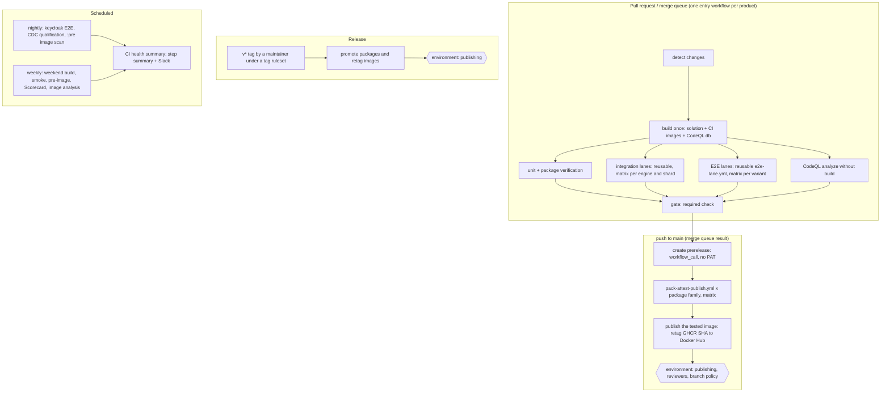

# Data-Management-Service: workflow structure, events and reuse review

**Audience:** senior DevOps engineer, new to this repo, coming from GitLab CI
**Status:** DRAFT for team review. Proposals only. Nothing in the repo was changed.
**Context:** Jira DEVOPS-157 (epic DEVOPS-154). Companion of [ci-workflow-review.md](./ci-workflow-review.md) (numbers and roadmap) and [dockerfile-review.md](./dockerfile-review.md). Baselines: the ODS-Admin-API and Ed-Fi-AdminApp structure reviews (DEVOPS-155, DEVOPS-156), where DMS was the reference for merge queue, GHCR images, lock-file automation and environments. Here DMS is the subject, so the questions are **complexity, review cost and maintainability**, not missing basics.
**Evidence:** the 36 workflow files (15,239 lines) and 4 composite actions parsed with a YAML reader; the registered-workflow list, rulesets, environments and 30 days of runs read with `gh`; `eng/ci/*.ps1` and their 25 Pester test files; `docs/CI-PUBLISHING-CREDENTIALS.md` and `docs/NUGET-LOCK-FILES.md`.

---

## 1. Current event map

| Workflow | Events | Jobs | Notes |
|---|---|---|---|
| `on-dms-pullrequest.yml` (4,310 lines) | `pull_request` (main, 5 types), `merge_group: checks_requested`, `workflow_dispatch` | 39 (about 49 with matrices) | Change detection, BIDI scan, Pester, lock files, package verification, solution build, unit tests, 8 integration families, CDC qualification, 5 E2E variants + 3 instance-management E2E, OpenAPI spec validation, fresh rebuild, timing summary, `event_file`, **`DMS CI Gate`** |
| `on-config-pullrequest.yml` (948 lines) | same three events | 14 (about 18) | Change detection, BIDI, lock files, parity Pester, security-metadata tools, unit, integration, 3 E2E matrices (keycloak + self-contained), secrets contract, fresh rebuild, `event_file`, **`Config CI Gate`** |
| `codeql-analysis.yml` | `push` main and `pull_request` on `src/**/*.cs`, `*.csproj`, `Directory.Packages.props` | 1 | Dependency review + CodeQL C# **with a full build of both solutions** (38 min median) |
| `powershell-analysis.yml` | `push` main, `pull_request` on `*.ps1`, `*.psm1`, `.github/**` | 2 | Reusable `powershell-analyzer.yml@main` + workflow-ref-injection guard |
| `on-pullrequest-dockerfile.yml` | `push` main, `pull_request` on the two Dockerfiles, `workflow_dispatch` | 1 (matrix 2) | Hadolint, build, Docker Scout, SARIF, fail on critical/high |
| `scheduled-smoke-test.yml` | `schedule` Sat 08:30, `pull_request` (20 paths), `workflow_dispatch` | 5 | Builds the populated template (reusable), CI images, SDK, runs smoke legs (pgsql/mssql x DS 5.2/6.1) |
| `EdFi.Api.{Minimal,Populated}.Template.{MsSql,PostgreSQL}.yml` (4 files) | `pull_request` (about 35 paths each), `push` main + `v*` tags, `release: released`, `workflow_dispatch` | 2-3 each, calling `build-minimal-template.yml` (8 jobs) or `build-populated-template.yml` (9 jobs) per DS version | Build, SBOM, SLSA provenance, signing (`template-attestation-signing`), publish (`publishing`) **on every push to `main`**, promote on release |
| `Pkg EdFi.Api.Sdk.yml`, `Pkg EdFi.Api.TestSdk.yml` | `push` `v*` tags, `release: released`, `workflow_dispatch` | 1 each, calling `build-sdk-package.yml` (6 jobs) x 2 DS versions | SDK packages |
| `Pkg EdFi.Api.SecurityMetadataTools.yml` | `workflow_dispatch` only | 6 | Manual pack/publish of one tool (1 run ever); the same package is also packed by `on-prerelease.yml` |
| `dependabot-lock-file.yml` | `pull_request` on `Directory.Packages.props` and lock files | 1 | Regenerates lock files on Dependabot PRs with `GITHUB_TOKEN` |
| `on-dms-merge-or-tag.yml`, `on-config-merge-or-tag.yml` | `push` main + `v*` tags, path-filtered (`src/dms/**`+`src/plugins/**` / `src/config/**`+`src/plugins/**`) | 1 each | Create `dms-pre-*` / `cs-pre-*` prerelease with `EDFI_BUILD_AGENT_PAT` (`release-automation` environment) |
| `on-prerelease.yml` (2,718 lines) | `release: prereleased`, `workflow_dispatch` (dry run) | 43 | Per package family: pack, SBOM, SLSA provenance (fork `@v2.0.0`), contract check, publish (`publishing`), attach assets, Docker Hub publish (`Nuget.Dockerfile`) |
| `on-release.yml` | `release: released`, `workflow_dispatch` | 4 | Delete superseded prereleases and tags, promote 8 packages in Azure Artifacts, retag the two images |
| `on-merge-group-cla.yml` | `merge_group` | 1 | Posts a `license/cla` status on the queue commit (CLA app only answers PRs) |
| `scheduled-merge-queue-enqueue.yml` | `schedule` 02:00, 05:00, 08:00 UTC, `workflow_dispatch` | 1 | Enqueues approved PRs overnight with the PAT |
| `nightly-keycloak-e2e.yml` | `schedule` Sun-Fri 08:00, `workflow_dispatch` | 2 (matrix 4 shards) | Keycloak variant of the DMS E2E, Slack notify |
| `nightly-cdc-qualification.yml` | `schedule` daily 08:17, `workflow_dispatch` | 3 (matrix up to 18 suites) | Story-owned CDC suites against packaged-history databases, Slack notify |
| `dms-weekend-build.yml` | `schedule` Sat 08:00, `workflow_dispatch` | 7 | Visual Studio MSBuild on `windows-2025-vs2026`, keycloak E2E, document-cache E2E, OpenAPI specs, Slack notify |
| `scheduled-pre-image-test.yml` | `schedule` Sat 08:30, `workflow_dispatch` | 1 | E2E against the published `:pre` images, Slack notify |
| `scheduled-secret-resolution-proof.yml` | `schedule` Mon-Fri 06:30 | 1 | DMS-1554 proof (7 min) |
| `scheduled-stock-plugin-proof.yml` | `schedule` Tue 07:15 | 2 | DMS-1502 proof; skips until a qualifying release exists (reports "not ready") |
| `analyze-docker-images.yml` | `schedule` Sun 00:00, `workflow_dispatch` | 2 (matrix 2) | Rebuild from source and Scout scan, SARIF |
| `cleanup-dms-ci-ghcr-images.yml` | `schedule` Sun-Fri 08:00 | 3 | Keep 100 CI image versions, protect `buildcache`, verify, Slack notify |
| `scorecard.yml` | `schedule` Sun 23:15, `push` main | 1 | OpenSSF Scorecard (8.3 on 2026-11-12) |
| `after-pullrequest.yml` | `workflow_run` of **"On Pull Request"** | 1 | **Never runs: no workflow has that name** (0 runs ever) |
| `on-issue-opened.yml` | `issues: opened` | 1 | 0 runs ever |
| `copilot-setup-steps.yml` | `push` and `pull_request` on its own file | 1 | **602 runs**: `paths` filters do not apply to tag pushes, so every `dms-pre-*` and `cs-pre-*` tag starts it (93 runs in 30 days) |

Registered but file deleted (ghost entries in the Actions list): `EdFi.Dms.Populated.Template.PostgreSQL.yml` (8 runs, last 2026-06-26), `backfill-document-cache-admin.yml` (0 runs), `config-database-topology-matrix.yml` (10 runs, last 2026-07-25), `on-mssql-template-pullrequest.yml` (1 run, 2026-07-14).

The delivery chain is **event-chained across workflows**, as in the sibling repos, with one extra hop (the merge queue):

```
PR -> on-dms-pullrequest + on-config-pullrequest + codeql + powershell (+ 4 templates + smoke when paths match)
   -> approval -> merge queue (merge_group runs of both PR workflows, CLA shim)
   -> push main -> on-{dms,config}-merge-or-tag --(PAT creates dms-pre-*/cs-pre-* release)--> on-prerelease
   -> (manual) v* tag + release --> on-release (promote), Pkg * workflows (publish SDK and templates)
```

What is required to merge (ruleset `main`, readable): `DMS CI Gate`, `Config CI Gate` (non-strict) and `license/cla` (strict); one approval, code-owner review, last-push approval; merge queue with `SQUASH`, `max_entries_to_build: 1`, `min_entries_to_merge: 1`, `max_entries_to_merge: 3`, 5-minute wait, `ALLGREEN`, 240-minute check timeout.

---

## 2. Findings

Priority: **H** high value, **M** medium, **L** low.

### 2.1 Events and triggers

| # | Finding | Evidence | Why it matters | Pri |
|---|---|---|---|---|
| E1 | **Both PR workflows start on every PR and skip inside.** Neither has `paths:`; instead `detect-fresh-build-changes` computes `dms_relevant` / `config_relevant` plus four narrower categories (`backend_mssql`, `dms_api`, `schematools`, `cdc`) and every job carries `if: github.event_name != 'pull_request' \|\| needs...outputs.X == 'true'`. On `merge_group` everything runs. | `eng/ci/dms-change-categories.psm1`; the 39 `if:` lines | This is the right pattern for a required gate (a path-filtered workflow would leave the gate "pending"), and `DmsPullRequestCiBudget.Tests.ps1` guards the wiring. The cost is 39 near-identical `if:` expressions that every new job must copy, and a skip that still creates a run record (145 "skipped" DMS runs in 30 days are draft PRs). | M |
| E2 | **The same push starts up to nine workflows.** For a PR touching `src/dms/backend/**` or `eng/docker-compose/*`, one push starts both PR workflows, CodeQL, PowerShell, the four template workflows and the smoke test (39 pushes in 30 days did exactly that). | run data grouped by head commit and minute | Nine independent runs, nine queues, nine `concurrency` groups, and a PR page with about 70 checks. Only the two gates are required, so the other seven are informational by rule but noisy by experience. | H |
| E3 | **Template packages are built, signed and published on every push to `main`** whose paths match (81 push runs per template workflow in 30 days, 2 DS versions each, 11 to 23 min). `publish-*-template` runs for `main` with `publish_package: true` into the `publishing` environment. | wrapper `if:` expressions; run list | Up to 8 template packages published per merge, each with SBOM, provenance and signature. Useful for the `pre` channel; expensive if nobody consumes intermediate template versions. | M |
| E4 | **CodeQL builds both solutions under the CodeQL tracer on every C# PR and every push to `main`** (348 PR runs, 56 push runs; 38 min median; cancelled 26 times by newer pushes). Dependency review runs inside the same job. | `codeql-analysis.yml`; run data | The PR workflow already builds the DMS solution; CodeQL builds it again (plus CMS) with instrumentation. `build-mode: none` for C# (supported since CodeQL 2.16) removes the build. This is the single largest "duplicate build" in the repo. | H |
| E5 | **`copilot-setup-steps.yml` runs on every prerelease tag** (93 runs in 30 days, 602 ever) because `on.push.paths` does not apply to tag pushes. Harmless (0.6 min) but it is the same bug the AdminApp review found (S6). | run list heads: `dms-pre-*`, `cs-pre-*` | Noise in the Actions list; trivially fixed with `branches: [main]`. | L |
| E6 | **Two workflows can never run and four registered workflows have no file.** `after-pullrequest.yml` subscribes to "On Pull Request" (the workflows are named "On DMS Pull Request" and "On Config Pull Request"), so it has 0 runs ever, and the `event_file` jobs that exist for it (DMS 24-job `needs`, CMS 10-job `needs`) upload an artifact nobody reads. `on-issue-opened.yml` has 0 runs ever. | `gh api .../workflows/<file>/runs` | Dead code in the two largest files and ghost entries in the UI. Deleting them is the cleanest quick win in this review. | M |
| E7 | **Schedules:** eleven crons across ten workflows. Overnight (UTC) 02:00/05:00/08:00 queue enqueue; 06:30 secret proof (Mon-Fri); 08:00 Keycloak E2E and GHCR cleanup (Sun-Fri); 08:00 weekend build and 08:30 smoke and pre-image tests (Sat); 08:17 CDC qualification (daily); 07:15 stock plugin proof (Tue); Sun 00:00 image analysis; Sun 23:15 Scorecard. | `schedule:` blocks | Reasonably staggered. The 08:00-08:30 window on Saturday starts three heavy workflows at once (weekend build 97 min, smoke 43 min, pre-image 60 min). Three of the four weekend builds in 30 days failed; the nightly CDC qualification failed 6 of 31 times; Slack is the only sink. | M |
| E8 | **The merge queue works, with a serial profile.** `max_entries_to_build: 1` means one queue entry is built at a time; each entry re-runs both PR workflows in full (47 min median for DMS). 93 queue runs in 30 days, 5 DMS and 11 CMS failures (an entry is dequeued and the PR must be re-queued; the overnight enqueue retries). Queue runs cluster between 15:00 and 23:00 UTC (71 of 93), so the "overnight" enqueue is a minority. | ruleset JSON; run data | Each merge costs one PR run plus one queue run (about 500 runner-minutes). With `max_entries_to_build: 1` the queue cannot batch, so throughput is one merge per 50 min at best. Whether a larger build batch is wanted is a team decision (a failed batch is rebuilt). | M |

### 2.2 Flow, gating and promotion

| # | Finding | Evidence | Why it matters | Pri |
|---|---|---|---|---|
| F1 | **One gate job per PR workflow, and both are required.** `dms-ci-gate` (`needs` 35 jobs, `if: always()`, fails unless every result is `success` or `skipped`) and `config-ci-gate` (12). The hypothesis in the ticket that DMS has no gate was wrong. | `on-dms-pullrequest.yml` lines 4246-4310; ruleset | This is the pattern the other two repos should copy (ODS-Admin-API L3, AdminApp L3). One caveat: a job that is skipped by a wrong `if:` passes the gate silently; the Pester wiring test covers the categories but not every job. | n/a |
| F2 | **Build once is implemented inside the DMS PR workflow** (`build-dms-solution` -> `dms-build-output` artifact of about 1.1 GB -> 11 consumer jobs) and across jobs for images (GHCR by SHA), but **not across workflows or into the release**. The same commit is compiled: once by `build-dms-solution`, once by `verify-dms-packages` (`BuildAndPublish`), once inside each CI image (2 images), once by CodeQL (both solutions), 2 to 6 times by the CMS PR jobs (`build-config.ps1 Build` in unit, integration and each E2E leg), again by the template and smoke workflows, and at release once per package family (`pack-dms`, `pack-schema-tools`, `pack-plugins`, `pack-custom-validation`, `pack-identity`; `pack-cs`, `pack-secrets`, `pack-security-metadata-tools`). | the `Build` steps counted per job | Measured compile cost: 5.8 min per DMS build (`Build` step median 346 s), 3 min per CMS build. The released package is the third build of the commit, not the tested one (same finding as ODS-Admin-API F1). | H |
| F3 | **Release creation still goes through a PAT** (`EDFI_BUILD_AGENT_PAT`), now scoped to the `release-automation` environment, and prereleases are cut on every merge (52 DMS + 38 CMS tags in 30 days; 91 prerelease runs). `publishing` holds the publish tokens. **None of the three environments has protection rules yet** (`protection_rules: []`, no deployment-branch policy), so the environment move is complete in the YAML but the GitHub setup (steps 1-4 of `docs/CI-PUBLISHING-CREDENTIALS.md`, DMS-1647 to DMS-1649) is pending. | `gh api repos/.../environments`; the doc's verification table | Until the environments are protected, any branch that names `publishing` can read the tokens, exactly as the doc says. This is the most important open security item and it is a settings change, not a workflow change. | H |
| F4 | **`on-prerelease.yml` repeats one 5-job chain per package family** (pack -> SBOM + provenance -> contract check -> publish -> attach), eight times, with family-specific `if:` and `needs:` (for example `publish-package-dms` needs the three contract publishes). 43 jobs, 12 SLSA generator calls (each compiles the generator: 92 s), 43 jobs without `timeout-minutes`. | job graph | 2,718 lines to review for a change that is conceptually one line ("add a package family"). A matrix over a family list, or a reusable `pack-attest-publish.yml` called 8 times, would cut the file by an estimated 70 to 80% and remove the per-family drift risk. Review cost today is the main argument, not minutes. | H |
| F5 | **Publishing sleeps 20 s and downloads the package without verifying it** before building the Docker Hub image. 19 of 91 prerelease runs failed in 30 days. | `docker-publish-dms` step list | Same race the ODS-Admin-API review flagged (S3). See `dockerfile-review.md` DF4 for the fix. | M |
| F6 | **Release promotion is a manual GitHub release on a `v*` tag.** `on-release.yml` deletes superseded prereleases with `GITHUB_TOKEN`, promotes 8 packages in Azure Artifacts and retags the two images from `:pre`. Tag rulesets to restrict `v*`, `dms-pre-*` and `cs-pre-*` creation (doc step 4) are not in place (rulesets: `cla`, `main`, `patch` only). | rulesets list | Anyone with push rights can create a release tag; the environment gate (F3) would be the stop, once configured. | M |
| F7 | **The `merge_group` runs re-run everything that the PR run already passed on the same tree**, because the queue builds a new merge commit. Path categories are forced to "all relevant" on `merge_group`. | `Write-DmsChangeCategories.ps1`: `EventName != pull_request` -> all true | Correct for safety; the cost is a second 47-minute run per merge. The only lever without changing the queue is to make the PR run cheaper (the queue run cannot be skipped). | M |

### 2.3 Structure and reuse

| # | Finding | Evidence | Why it matters | Pri |
|---|---|---|---|---|
| R1 | **The repo has real reuse: 3 reusable workflows, 4 composite actions, 10 PowerShell modules under `eng/ci`, and 25 Pester test files that lint the workflows themselves** (`DmsPullRequestCiBudget`, `ReleasePublishingCredentials`, `WorkflowRefGuard`, `TemplateWorkflowAttestation`, ...). | `ls eng/ci/tests` | This is unusual and good: workflow behavior is unit-tested. It is also why changes are expensive: a job rename touches YAML, a test and sometimes a module. Export candidates for `Ed-Fi-Actions` are listed in section 5. | n/a |
| R2 | **The E2E job body is copied eight times inside `on-dms-pullrequest.yml`** (`run-e2e-tests`, `-ds61`, `-partition-sizing`, `-mssql`, `-mssql-ds61`, three `run-instance-management-*`): about 190-230 lines each, differing in the env file, the test filter, the image-build fallback and the artifact names. The Config PR has the same shape three times. | job sizes (steps 17-20 each) | One reusable `e2e-lane.yml` (inputs: engine, env file, filter, identity provider, shard) called with a matrix would replace about 1,700 lines. The fallback image-build block alone is repeated in 8 jobs (see `dockerfile-review.md` DF7). | H |
| R3 | **The integration-test jobs repeat a 5-step preamble** (checkout, setup-dotnet, download assemblies, start database container composite action, run, upload results, timings) in 9 jobs. The database start is already a composite action; the rest is not. | job step lists | A composite action `run-integration-lane` would cut about 600 lines; lower priority than R2 because these jobs are short and stable. | M |
| R4 | **Five template wrapper workflows differ by 10 lines** (name, two or three paths, package names, `database_engine`). The two reusable workflows they call are 994 and 1,038 lines with the same 8-9 job shape. | `diff` of the MsSql and PostgreSQL wrappers | One wrapper with a 4-leg matrix (engine x template) and one reusable `build-template.yml` with a `template_kind` input would remove 4 files and about 1,000 lines. The PR path lists would also stop drifting (they already differ in `postgresql-init.sh`). | M |
| R5 | **Three `@main` references remain**: `repository-scanner.yml@main` (twice, in the required-gate `needs`) and `powershell-analyzer.yml@main`; everything else is SHA-pinned (122 `actions/checkout` pins alone). The SLSA generator is a fork pinned by tag `v2.0.0`. | `grep uses:` | A change in `Ed-Fi-Actions` `main` changes the required DMS check without a DMS PR. The fork tag is immutable only by convention. Scorecard already gives 8/10 for pinning. | M |
| R6 | **`concurrency` is set on 12 of 36 workflows and `timeout-minutes` on 3 jobs out of about 180.** The PR workflows cancel superseded runs (50 cancelled DMS PR runs in 30 days, that is the feature working). `on-prerelease.yml` has neither; two quick merges run two prereleases in parallel into the same feed and `:pre` tag. | inventory | Default 360-minute job timeout; the merge-queue check timeout is 240 min. A hung E2E job (the AdminApp review saw 6-hour hangs) blocks a queue entry for 4 hours. | M |
| R7 | **Workflow-level `permissions: read-all`** on most files with job-level narrowing where needed; the template wrappers set `contents: write, actions: read, id-token: write` at the top. Scorecard scores `Token-Permissions` 0/10 because of the top-level write. | `permissions:` blocks; Scorecard API | Move the write permissions to the jobs that publish or attest; the reusable workflows already declare job permissions. | L |
| R8 | **No document explains the workflow set.** `docs/` has excellent single-topic pages (lock files, credentials, CDC qualification) and the PR workflow is tested, but there is no "CI map" that says which workflow runs when, what is required, and what a developer should look at first when a check is red. | `docs/` listing; README links | For a 15,000-line pipeline this is the onboarding cost. This review's section 1 table is a starting point. | M |

---

## 3. Proposed target design

The target keeps what works (gate jobs, merge queue, GHCR images by SHA, environments, lock-file automation, Pester-tested wiring) and attacks size and duplication.



Principles:
1. **One entry workflow per product, thin; logic in reusable workflows and composite actions.** `on-dms-pullrequest.yml` becomes a job list that calls `e2e-lane.yml`, `integration-lane.yml` and a `dotnet-build` composite; the gate stays where it is.
2. **Build once per commit, everywhere.** CodeQL analyzes without building; the CMS PR builds once and shares output like DMS does; the release retags the image that was tested, or at least verifies the package it downloads.
3. **Matrix over package families** in the prerelease instead of eight copies of the chain.
4. **Environments are the boundary**, so finish the GitHub-side setup (reviewers, branch policies, tag rulesets) before touching the YAML further.
5. **Templates publish on demand or on tags**, not on every merge, unless someone consumes the `pre` template feed (question for the team).
6. **Scheduled lanes report to one place** (a CI health summary that the weekly review reads), and each cron has an owner.

### Proposed event matrix

| Entry workflow | Events | Calls |
|---|---|---|
| `on-dms-pullrequest.yml` (thin) | `pull_request`, `merge_group`, `workflow_dispatch` | `detect`, `dotnet-build` composite, `integration-lane.yml` (matrix), `e2e-lane.yml` (matrix), `codeql` (no build), `gate` |
| `on-config-pullrequest.yml` (thin) | same | `detect`, shared build output, `e2e-lane.yml` (CMS inputs), `gate` |
| `on-merge-or-tag.yml` (one file, two products by matrix) | `push` main (path-filtered per product), `v*` tags | prerelease creation via `workflow_call` of `release.yml` when GitHub allows it, else the PAT in `release-automation` as today |
| `release.yml` | `release: prereleased` / `released`, `workflow_dispatch` | `pack-attest-publish.yml` x family (matrix), image publish, promotion behind `publishing` |
| `templates.yml` (one file) | `pull_request` (one path list), `push` `v*` tags, `release`, `workflow_dispatch` | `build-template.yml` with a 4-leg matrix (engine x minimal/populated) x DS version |
| `nightly.yml` / `weekly.yml` | `schedule` | keycloak E2E, CDC qualification, `:pre` image scan, weekend build, smoke, pre-image, Scorecard, GHCR cleanup, with one `summary` job |
| `dependabot-lock-file.yml` | `pull_request` by actor | unchanged (export candidate) |
| `housekeeping` | `schedule` | ghost-workflow and cache cleanup, prerelease retention |

---

## 4. Proposals

IDs match the roadmap in `ci-workflow-review.md` (S = short, M = mid, L = long). Only the structural ones are listed here.

### 4.1 Short term (days, low risk)

| ID | Proposal | Findings | Review and maintenance cost |
|---|---|---|---|
| S19 | **Delete** `after-pullrequest.yml`, `on-issue-opened.yml`, the two `event_file` jobs and their `needs`; delete the run history of the four ghost workflows; add `branches: [main]` to `copilot-setup-steps.yml`. | E5, E6 | One PR, about 100 lines removed, nothing to maintain afterwards. |
| S6 | `timeout-minutes` on every job (values from the measured p90s: E2E 40, integration 45, prerelease jobs 20, CDC qualification keeps 120); `concurrency` without cancel on `on-prerelease.yml` and `on-release.yml`. | R6 | About 180 one-line additions; the Pester tests may need a guard that every job has one, which then prevents regressions. |
| S7 | Pin `repository-scanner.yml` and `powershell-analyzer.yml` to a SHA (or ask `Ed-Fi-Actions` for release tags); keep the fork tag until L7 replaces the generator. | R5 | One line each; a Dependabot `github-actions` ecosystem keeps them fresh. |
| S20 | **Finish the environment setup** from `docs/CI-PUBLISHING-CREDENTIALS.md`: reviewers and branch policy on `publishing`, branch policy on `release-automation`, the tag rulesets, then remove the repository and organization copies of the four secrets. | F3, F6 | Settings only; closes DMS-1647 to DMS-1649. |
| S21 | **CodeQL `build-mode: none`** for C# and move dependency review to its own 1-minute job. | E4 | Two lines; a trial on one PR shows whether the alert set changes. |

### 4.2 Mid term (weeks)

| ID | Proposal | Findings | Review and maintenance cost |
|---|---|---|---|
| M1 | **Share the build output in the Config PR workflow** (one `build-config-solution` job plus an artifact), the way DMS does. | F2 | About 150 lines added, 5 `Build` steps removed; copies a proven pattern. |
| M6 | **Extract `e2e-lane.yml`** (reusable, inputs for engine, env file, filter, identity provider, shard, prebuilt images) and replace the 8 DMS and 3 CMS E2E jobs by matrix calls; then `integration-lane` as a composite action. | R2, R3 | The largest refactor in this review (about 2,000 lines removed). Needs the Pester wiring tests updated; do it lane by lane with the timing summary as the regression check. |
| M18 | **Matrix or reusable chain for `on-prerelease.yml`** (`pack-attest-publish.yml` called per family with `secrets: inherit` inside `publishing`). | F4 | About 2,000 lines removed; the contract-check ordering (`publish-package-dms` after the three contracts) becomes a `needs` on the matrix job. |
| M19 | **One template wrapper with a matrix and one reusable template workflow** (`template_kind` input). | R4 | 4 files and about 1,000 lines removed; one path list to maintain. |
| M20 | **Decide the template publish cadence**: publish on `v*` tags and on demand, build-only on `main`, unless the `pre` template feed has consumers. | E3 | A `publish_package` input change; saves the signing and publish jobs on every merge. |
| M21 | **CI map document** (`docs/CI.md`): the section 1 table, what is required, how to read a red check, how to reproduce each lane locally with `build-dms.ps1`. | R8 | One page; kept current by the same PRs that change workflows (CODEOWNERS already routes `.github/**` to the automation owners). |

### 4.3 Long term (quarter and beyond)

| ID | Proposal | Findings | Review and maintenance cost |
|---|---|---|---|
| L2 | **Release the tested artifact**: retag the GHCR image of the merge commit to Docker Hub and attest it; derive the package from the same publish output. Rethink prerelease-on-every-merge (90 prereleases in 30 days). | F2, F5 | Changes the release model; needs the Director's decision and a documented rollback. |
| L4 | **Export to `Ed-Fi-Actions`**: lock-file workflow, `pull-ci-images`, the database container actions, the gate pattern, `e2e-lane.yml` (once extracted), the Pester workflow-lint tests, `Test-WorkflowRefInjection.ps1`. | R1 | One owner per fix across the three repos; version the shared repo with tags. |
| L3 | **Merge queue tuning**: trial `max_entries_to_build: 2-3` for a week and compare merges per day and rebuild count; keep `ALLGREEN`. | E8 | A ruleset change with a measured trial. |
| L7 | **Replace the SLSA generator fork with `actions/attest-build-provenance`** for packages and images (DEVOPS-158 PoC). | F4 | Removes 12 reusable calls and the fork from the dependency list. |

---

## 5. What DMS does well and should be exported

| Pattern | Where | Export to | Notes |
|---|---|---|---|
| Single required gate job with `needs` all and `if: always()` | `dms-ci-gate`, `config-ci-gate` | ODS-Admin-API (L3), AdminApp (L3), `Ed-Fi-Actions` docs | Pair it with change detection so skipped jobs pass. |
| Change categories computed by a tested PowerShell module | `eng/ci/dms-change-categories.psm1` + Pester | `Ed-Fi-Actions` composite action | Replaces `paths:` where a gate is required. |
| Build once per PR: solution artifact and GHCR CI images by SHA with cleanup and cache verification | `build-dms-solution`, `build-ci-docker-images`, `cleanup-dms-ci-ghcr-images.yml` | both sibling repos (M3/M4/L5 there) | Keep the "no cache write from PRs" rule. |
| Lock-file regeneration on Dependabot PRs plus the documented recovery | `dependabot-lock-file.yml`, `docs/NUGET-LOCK-FILES.md` | ODS-Admin-API (S1) | Already proposed there. |
| Pull retry with jittered backoff; resource-limited database containers with tmpfs | `.github/actions/*` | `Ed-Fi-Actions` | Four small composite actions, no secrets. |
| Environment-scoped publishing tokens with a written setup and verification plan | `docs/CI-PUBLISHING-CREDENTIALS.md` | AdminApp (M13/L8), ODS-Admin-API (M13) | Finish the setup here first (S20). |
| Workflow-lint tests: ref-injection guard, credential-scope test, CI-budget wiring test | `eng/ci/tests/*.Tests.ps1`, `Test-WorkflowRefInjection.ps1` | `Ed-Fi-Actions` reusable workflow | Equivalent of `actionlint` + `zizmor` with repo-specific rules. |
| Test timing summary per lane and aggregate | `eng/ci/summarize-test-timings.ps1` | both repos (S16/S18) | Already the seed of a CI health trend. |
| Merge queue with a CLA shim and overnight enqueue | ruleset, `on-merge-group-cla.yml`, `scheduled-merge-queue-enqueue.yml` | AdminApp (M14) | Document the serial profile and its cost. |

---

## 6. Suggested order

1. S19, S6, S7, S21 (a day each, no behavior change except CodeQL, which is trialed).
2. S20 (settings; unblocks the security findings).
3. M20 and M1 (cost and speed with small diffs).
4. M6, then M18, then M19 (structure; each one measured with the timing summary).
5. L2, L3, L4, L7 (decisions).

---

## 7. Questions for the development team

```bash
R=Ed-Fi-Alliance-OSS/Data-Management-Service
# Q1: is after-pullrequest.yml meant to run? (0 runs ever; the subscribed name does not exist)
gh api "repos/$R/actions/workflows/after-pullrequest.yml/runs?per_page=1" -q .total_count
grep -n '^name:' .github/workflows/on-dms-pullrequest.yml .github/workflows/on-config-pullrequest.yml
# Q2: who consumes the template packages published on every push to main?
gh run list -R $R --workflow EdFi.Api.Minimal.Template.PostgreSQL.yml --event push --limit 5 --json headBranch,conclusion,displayTitle
# Q3: was CodeQL build-mode none tried?
git log --oneline -S 'build-mode' -- .github/workflows/codeql-analysis.yml
# Q4: environments: are the protection rules planned, and who owns the org-secret removal?
gh api repos/$R/environments -q '.environments[] | "\(.name) rules=\(.protection_rules|length) policy=\(.deployment_branch_policy)"'
gh api repos/$R/rulesets -q '.[] | "\(.name) \(.target)"'
# Q5: merge queue profile: was max_entries_to_build > 1 ever tried?
gh api repos/$R/rules/branches/main -q '.[] | select(.type=="merge_queue") | .parameters'
# Q6: nightly and weekend failures: who reads the Slack channel, and what happened to the 3 failed weekend builds?
gh run list -R $R --workflow dms-weekend-build.yml --limit 6 --json createdAt,conclusion,event
gh run list -R $R --workflow nightly-cdc-qualification.yml --status failure --limit 10 --json createdAt
```

**Found:** Q1: 0 runs; names are "On DMS Pull Request" and "On Config Pull Request". Q2: the last five `main` pushes each published both DS versions. Q3: no commit mentions `build-mode`. Q4: three environments (`copilot`, `publishing`, `release-automation`), all with 0 protection rules and no branch policy; rulesets `cla`, `main`, `patch` (no tag ruleset). Q5: `max_entries_to_build: 1`, `ALLGREEN`, squash. Q6: weekend build failed on 2026-10-17, 10-24 and 10-31 (succeeded 11-07); CDC qualification failed 6 times in 30 days.

---

## 8. Limits

- Branch rulesets, environments and the workflow list were readable; repository secrets, variables, Actions policy and code-scanning alerts were not (403). Statements about protection rules are facts; statements about secret placement rely on the doc.
- Line counts and job counts are from the checkout at `38c758539` (2026-11-12).
- The "nine workflows per push" count is from grouping runs by head branch and creation minute over 30 days; a push that only changes docs starts fewer.
- The estimated line reductions are from the sizes of the duplicated blocks, not from a prototype.
- No repository file was changed.
