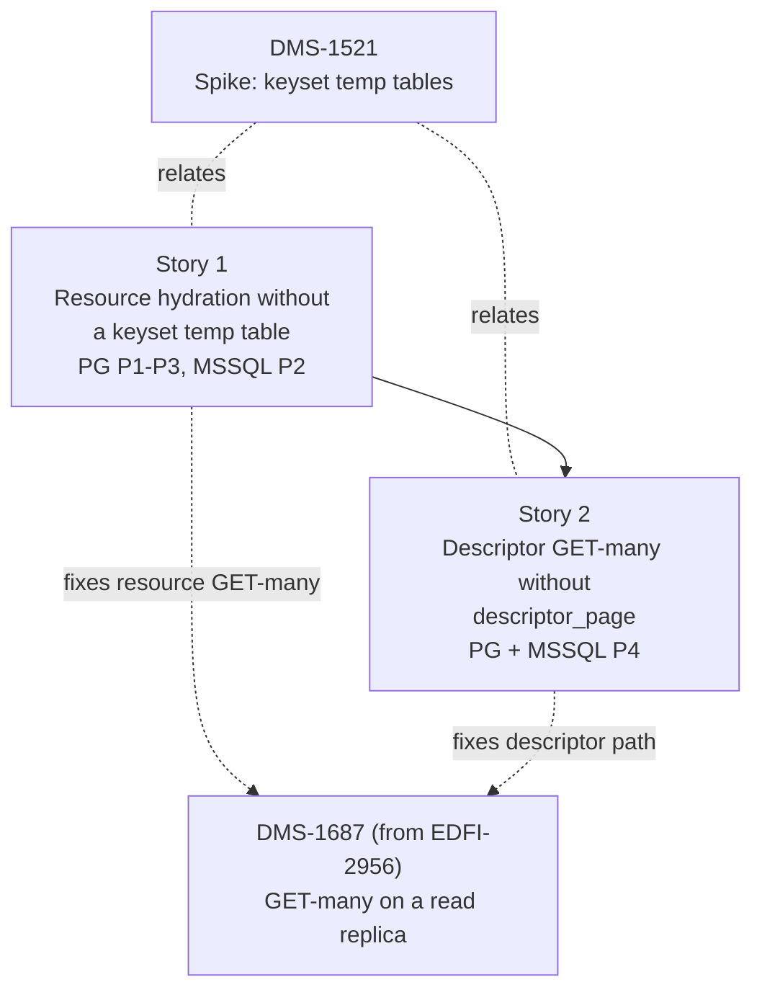

# DMS-1521 Candidate Implementation Stories

## Recommended story decomposition

The [spike findings](keyset-temp-table-findings.md) recommend removing the per-request keyset temp
table from every multi-document path on PostgreSQL. On SQL Server they recommend removing it from
the read-acceleration candidate-metadata and descriptor paths, and keeping `#page` on resource
GET-many and the selected-page fallback (see
[Retained fallback](keyset-temp-table-findings.md#retained-fallback)). The work splits into two
stories:

| ID | Candidate story | Paths and engines | Estimate |
| --- | --- | --- | --- |
| [Story 1](story-1-resource-hydration-without-keyset-temp-table.md) | Resource multi-document hydration without a keyset temp table | PostgreSQL P1, P2, P3; SQL Server P2. Owns the shared keyset-contract work | 3 |
| [Story 2](story-2-descriptor-get-many-without-keyset-temp-table.md) | Descriptor GET-many without `descriptor_page` | P4 on PostgreSQL and SQL Server | 2 |

Paths, as numbered in the findings: P1 resource GET-many (query keyset), P2 read-acceleration
candidate metadata, P3 read-acceleration selected-page fallback, P4 descriptor GET-many.

Each story is filed with type Story, no parent, fix version `Ed-Fi API v8.2`, label `no-blockers`,
priority Medium, and no sprint. It is linked `relates to` DMS-1521, DMS-848, and DMS-1687, which stories 1 and 2 resolve together. Each file in this
folder becomes its story's Jira description and is renamed to `DMS-NNNN-<slug>.md` once filed.

### Conditional stories (not drafted)

| Story | Condition | Status |
| --- | --- | --- |
| 3. Interim PostgreSQL `ANALYZE` mitigation | Task 3's mitigation verdict is favorable (met), **and** either story 1 cannot ship in 8.2 or PostgreSQL has no validated replacement | Not triggered. PostgreSQL has a validated replacement. It is drafted only if the task 11 review decides that story 1 cannot ship in 8.2. Even then it covers the hydration and descriptor batches only, and it does not fix EDFI-2956 |
| 4. Provisioning | A validated recommendation uses a DDL-based option | Not triggered. Nothing recommended adds DDL. The SQL Server lead `memtablevar` (memory-optimized table variable) would need it, but it is unvalidated, and unvalidated leads never become story scope |

## Dependency and delivery order

- Story 1 depends on no other story; it starts when the task 11 review accepts the PostgreSQL
  carrier (see Ready-to-start gates). It defines the shared keyset contract: how a keyset that is not a table
  is rendered and bound, the PostgreSQL carrier and its set-before-read rule, and the SQL Server
  JSON carrier for a batch that selects its own page.
- Story 2 is blocked by story 1. It reuses the carrier name and rules on PostgreSQL, and the JSON
  carrier on SQL Server. The descriptor batch does not go through `AppendRelation`, so story 2
  changes `DescriptorReadHandler` itself.
- Jira links: story 1 **blocks** story 2. Both **relate to** DMS-1521, DMS-848, and DMS-1687.
- Story 1 fixes [DMS-1687](https://edfi.atlassian.net/browse/DMS-1687) (GET-many fails on a PostgreSQL read replica; cloned from
  [EDFI-2956](https://edfi.atlassian.net/browse/EDFI-2956)) for resource GET-many (P1). P2 and P3 never reach a replica: read
  acceleration falls back to P1 on a derivative target. The fix is complete only when story 2 also
  lands, because the descriptor batch issues the same DDL.

### Dependency graph

### Expected implementation locations

- Keyset contract, relation rendering, and batch assembly:
  `src/dms/backend/EdFi.DataManagementService.Backend.External/Plans/` and
  `src/dms/backend/EdFi.DataManagementService.Backend.Plans/` (`PlanSqlWriterExtensions`,
  `HydrationBatchBuilder`, `PgsqlPlanDialect`, `MssqlPlanDialect`).
- Callers: `src/dms/backend/EdFi.DataManagementService.Backend/RelationalDocumentStoreRepository.cs`
  and `DescriptorReadHandler.cs`.
- Tests: `Backend.Plans.Tests.Unit`, `Backend.Tests.Unit`, `Backend.Postgresql.Tests.Integration`,
  `Backend.Mssql.Tests.Integration`, and the API integration suite
  `src/dms/tests/EdFi.DataManagementService.Tests.Integration`.
- Performance harness (story 1): `src/dms/tests/EdFi.DataManagementService.Performance.Harness/Measurement/PgsqlPlanCapture.cs`,
  whose splitter rejects string literals and whose replay binds only page-selection values.
- Design documents: `reference/design/backend-redesign/design-docs/`.
- Operator doc and verification harness (story 2): `docs/SNAPSHOTS-AND-READ-REPLICAS.md` and
  `eng/verification/PublisherSnapshotInterop/`, which grant `TEMPORARY` for GET-many.

No story adds a project, and neither changes `RelationalMappingVersion` or the DDL.

### Requirement interpretation

- **Acceptance criteria are normative.** They state the observable behavior, the correctness
  requirements C1–C6, and the performance thresholds. Thresholds are written in the findings'
  directional form: metric, ratio (story branch ÷ `main`, same machine), and bound, with
  `m = min(max(2 × CV, 5%), 20%)` computed from the story's own three baseline runs; a cell whose
  `2 × CV` exceeds 20% is rerun, then reported as inconclusive, never passed. Threshold ids (E*, P*,
  N*) and reproduction commands (R*) refer to
  [Thresholds](keyset-temp-table-findings.md#thresholds).
- **Design-document edits are normative.** Each carries the warrant "mandated by DMS-1521's
  decision" and lands in the same PR as the code.
- **Implementation guidance is non-binding.** It points to `experiments/prototype.patch`, which
  passed every check for the paths in scope. An equivalent implementation is acceptable when every
  acceptance criterion and test passes. The prototype is a starting point, not a design: it uses
  a spike-only `DMS1521_KEYSET_VARIANT` switch that no story keeps, and it throws on one
  non-production path.
- Plan node types (`Index Scan` instead of `Seq Scan`) are supporting evidence, never a threshold.
  The ticket says full scans are not wrong for every page size or distribution.
- The SQL Server support floor is unconfirmed. SQL Server 2025 is the tested environment. Stories
  use only SQL Server 2016-level constructs (`OPENJSON`, `FOR JSON PATH`), which does not make
  SQL Server 2016 supported.

### Ready-to-start gates

| Story | Start condition |
| --- | --- |
| [Story 1](story-1-resource-hydration-without-keyset-temp-table.md) | Ready once the task 11 review accepts the PostgreSQL transaction-local carrier for production. |
| [Story 2](story-2-descriptor-get-many-without-keyset-temp-table.md) | Design may start now. Implementation starts once story 1's keyset contract (carrier name, set-before-read rule, SQL Server JSON carrier) is merged. |

## Story files

| Ticket | Story |
| --- | --- |
| [Story 1](story-1-resource-hydration-without-keyset-temp-table.md) | Resource multi-document hydration without a keyset temp table |
| [Story 2](story-2-descriptor-get-many-without-keyset-temp-table.md) | Descriptor GET-many without `descriptor_page` |

## Why two stories

- **Fewer.** One story would combine two different code paths. P1–P3 go through the shared seam
  (`AppendRelation`, the compiled `SelectByKeysetSql` in the mapping-set goldens, the batch builder,
  and binding). P4 is self-contained in `DescriptorReadHandler`, has its own test doubles, and
  carries the design drift in `partitioned-cursor-paging.md`. Kept together, the PR would mix about
  2,500 golden lines with a separate descriptor rewrite and its split-command test adaptation.
- **More.** Splitting by engine would build the same shared contract twice. Splitting P2 or P3 out
  of story 1 would separate them from the binding and relation work they need. A separate test or
  docs story would leave the code without its required changes (C6).

## Coverage mapping

| Findings item | Resolution |
| --- | --- |
| AC2, cardinality hypothesis (confirmed) | Story 1 removes the cause on PostgreSQL P1–P3 (no temp table without statistics); thresholds P1–P5 |
| AC3, PostgreSQL WAL and catalog work | Stories 1 and 2, threshold E1 (0 catalog tuples) and N6 (WAL) |
| AC3, SQL Server tempdb work and latch contention | Story 1 (P2) and story 2 (P4), thresholds E2 and E3. P1 and P3 keep `#page` (AC6) |
| AC4, recommendation per engine | Story 1 (PostgreSQL P1–P3, SQL Server P2) and story 2 (P4, both engines) |
| AC5, priorities and the SQL Server explanation | [Recommendation](keyset-temp-table-findings.md#sql-server-inline-on-descriptor-and-candidate-metadata-page-stays-on-p1-and-p3); no story for SQL Server P1 and P3 |
| AC6, retained `#page` (SQL Server P1, P3) | Documented in [Retained fallback](keyset-temp-table-findings.md#retained-fallback). Story 1 keeps those batches byte-identical (E5) and records the condition in `flattening-reconstitution.md` |
| AC7, thresholds | Each story's acceptance criteria |
| DMS-1687 (from EDFI-2956), read-only replica | Story 1 (P1) and story 2 (P4), threshold E4. Only P1 and P4 reach a replica; P2 and P3 run only on the primary, so story 1's read-only tests for them are hardening. Story 2 also drops the `TEMPORARY` grant from `docs/SNAPSHOTS-AND-READ-REPLICAS.md` and the snapshot interop harness, proves it with a live `CONNECT`-only PostgreSQL interop run, and adds the release's changelog entry |
| Performance harness `PgsqlPlanCapture` (rejects string literals; binds only page-selection values) | Story 1 updates it with a unit test, so the PostgreSQL resource hydration batches in the baseline and final-gate runs can still be captured. The final gate's PostgreSQL descriptor run (`Given_Postgresql_FinalGateDescriptorRun`) already fails on `main`: the capture rejects `--` comments (`PgsqlPlanCapture.cs` ≈109–110), and DMS-1401 (`8a4eda2f6`) added marker comments to the descriptor batch. Neither story changes that; story 1's literal support also accepts story 2's literals |
| Design drift, `descriptor_page` in `partitioned-cursor-paging.md` | Story 2 |
| Keyset contract in `mpack-format-v1.md` | Story 1 updates the contract description. No pack exists to reject: pack emission is not implemented |
| Test doubles and fixtures that depend on the keyset table | Story 1: the PostgreSQL `HydrationExecutorTests` splice, and the five `PostgresqlDescriptorProjectionTests` classes, whose shared fixture hand-writes `"page"` joins. Story 2: the SQL Server descriptor split site in `AuthoritativeTimestampReadConsistencyScenario`. `DescriptorReadCommandExecutor` needs no change only while the markers and its unqualified `MAX("ContentVersion")` / `MAX([ContentVersion])` match stay; story 2 keeps both or updates it |
| C5, single-document fast path | Unchanged; asserted in both stories |
| Guarded single-document keyset without the fast path (non-production) | Story 1: implement it under the new contract on PostgreSQL (the prototype throws; SQL Server keeps `#page`). It reads the substituted `@DocumentId` token under the guard and adds no result set, because its id is unknown at bind time and `GetResultSetCount` counts none. `flattening-reconstitution.md` names it as the per-dialect fallback |
| SQL Server recompiles (DMS-1248 comment) | Not observed in either variant; E3 guards it. No separate work |
| `memtablevar` (SQL Server P1, P3) | Unvalidated lead; no story. The task 11 review decides whether to validate it |
| `ANALYZE` interim mitigation | Conditional story 3, not triggered |

Every recommended path maps to a story, and every finding has a disposition. Neither story may
adopt an unvalidated lead or remove SQL Server's `#page` from P1 or P3.
